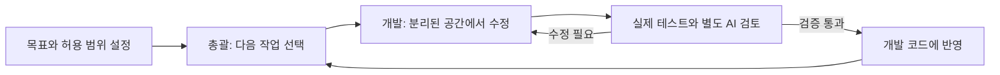

# agent-hub

여러 프로젝트에 목표를 맡기면, AI가 다음 할 일을 찾고 개발·테스트·검토를 이어가는 개인용 프로그램입니다.

예를 들어 학습 앱에 **“복습 기능을 완성하고 테스트로 확인해줘”**라는 목표를 설정합니다. agent-hub는 작업을 나누고, 코드를 수정하고, 결과를 검증한 뒤 다음 작업을 선택합니다. 매번 새 지시를 내릴 필요는 없습니다.

**현재:** 예제 프로젝트에서 실제 Codex가 서로 다른 작업 두 개를 수행하고 변경을 누적한 뒤 목표를 완료하는 흐름을 확인했습니다. 알림·외부 상태 점검 도구를 구현했으며, 실제 수신처 연결·장기 운영 검증은 남아 있습니다. **실제 서버의 24시간 무인 운영은 아직 검증하지 않았습니다.**

## 어떻게 동작하나



한 서버에서 한 작업을 실행하고, 총괄·개발·검토 역할은 순서대로 협업합니다. 작업 이력은 SQLite에, 누적 코드 변경은 원본과 분리한 Git 저장소에 보존합니다.

## 지금 가능한 것

| 기능 | 확인한 범위 |
| --- | --- |
| 목표에서 다음 작업 선택 | 허용한 코드·작업 이력·읽기 전용 서비스 관측을 근거로 계획 |
| 개발·검증·변경 반영 | 실제 Codex 수정, 별도 테스트, 독립 검토, 다음 작업에 변경 전달 |
| 중단과 제한 처리 | 취소, 종료 확인, 제한된 자동 복구, 사용 한도·기간 예산 대기 |
| 관리 화면 | 프로젝트·목표·작업·실행 이력·대기 이유·검토 결과 조회 |
| 공개 조회 화면 | 소유자가 공개한 이름·실행 상태만 조회, 비공개 프로젝트는 개수만 표시 |
| gstack 지침 | 내부 에이전트가 역할별 고정 지침을 읽고 적용 기록 저장 |
| 운영 준비 | Linux·HTTPS 설정 검사, 백업·복원, 문제 알림·외부 상태 점검 |

할 일이 없거나 예산이 부족하면 이유를 기록하고 기다립니다. 유한한 목표는 검증 후 완료하고, 지속 관리 목표는 정한 주기로 다시 살펴봅니다. 무의미한 작업을 끝없이 만드는 것을 목표로 하지 않습니다.

프로젝트 원본·실제 운영 서비스의 자동 변경, 원격 푸시·병합·배포는 별도 정책입니다. 현재 버전의 실행 규모는 **사용자 한 명·서버 한 대·동시 Run 한 개**입니다.

## 어디부터 읽으면 되나

| 알고 싶은 것 | 문서 |
| --- | --- |
| 코드 변경·검사·리뷰 방법 | [개발 참여 안내](CONTRIBUTING.md) |
| 전체 문서 중 필요한 것 찾기 | [문서 길잡이](docs/README.md) |
| Goal·Task·Run이 무엇이고 어떻게 연결되는지 | [구조와 동작 요약](docs/01-architecture.md) |
| 어디까지 끝났고 무엇이 남았는지 | [진행 상태와 완료 기준](docs/02-implementation-plan.md) |
| 왜 Node·pnpm·SQLite를 선택했는지 | [기술 선택과 대안](docs/03-technology-decisions.md) |
| 로그인·프로젝트·목표를 설정하는 방법 | [관리 화면 사용법](docs/guides/management.md) |
| Codex·Docker·자동 실행을 켜는 방법 | [AI 실행 설정](docs/guides/agents.md) |
| 운영 서버·HTTPS·백업을 준비하는 방법 | [운영 절차](docs/04-operations.md) |

## 로컬 실행

Node.js는 [`.nvmrc`](.nvmrc), pnpm은 [`package.json`](package.json)의 고정 버전을 사용합니다. 저장소 루트에서 실행합니다.

```sh
nvm install
nvm use
npm install --global pnpm@12.16.1
pnpm install --frozen-lockfile
LOCAL_API_ONLY=1 pnpm dev
```

다른 터미널에서 `curl http://127.0.0.1:3000/health/ready`로 서버와 DB 응답을 확인합니다. 종료는 `Ctrl+C`입니다.

이 명령은 **인증 없는 로컬 API 개발 모드**입니다. 관리 화면 로그인은 [로그인 설정](docs/guides/management.md#단일-사용자-로그인-설정), 실제 AI 작업은 [실행 설정](docs/guides/agents.md)이 추가로 필요합니다. 원격 운영에는 [운영 절차](docs/04-operations.md)를 적용합니다.

| 개발 명령 | 용도 |
| --- | --- |
| `pnpm format` | 코드 형식 정리 |
| `pnpm check` | 형식·기본 오류·모듈 참조 방향 검사 |
| `pnpm typecheck` | 타입 검사 |
| `pnpm test` | 자동 테스트 |
| `pnpm build` | 배포할 JavaScript와 화면 빌드 |
| `pnpm start` | 빌드한 서버 실행. 접근 모드 설정 필요 |

DB 변경·브라우저 테스트·Docker 검사 명령은 [로컬 개발 안내](docs/guides/local-development.md)에 모았습니다.

## 기술 스택

TypeScript, Node.js, Fastify, React·Vite, SQLite, better-sqlite3·Drizzle을 사용합니다. AI 연결은 Codex SDK, 실행 격리는 Docker, 운영 구성은 systemd·Caddy입니다. [선택 이유와 비교한 대안](docs/03-technology-decisions.md)을 기록합니다.

## 공개 저장소에 두는 것

코드·문서·가상 설정 예시를 공개합니다. 실제 프로젝트 소스, 인증, 서버 접속 정보, 작업 DB, 로그와 AI 결과는 비공개로 보관합니다. 공개 저장소의 CI는 개인 계정으로 인증한 에이전트를 호출하지 않습니다.

저장소 공개와 관리 화면의 공개 접근은 별개입니다. 소스의 공개 재사용을 허용할 라이선스도 별도로 선택합니다.
