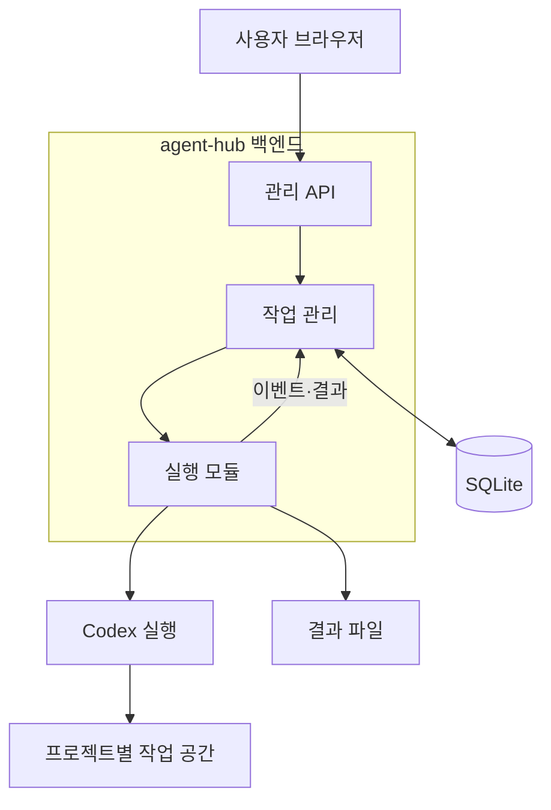

# agent-hub

여러 프로젝트에 작업을 지시하고, AI 에이전트의 실행 과정과 검증 결과를 한곳에서 확인하는 개인용 프로젝트 관리 시스템입니다.

사용자는 목표를 입력하고, agent-hub는 작업을 저장해 내부 실행 모듈로 처리합니다. 실행 모듈은 지정된 프로젝트에서 에이전트를 실행하고 진행 상황과 결과를 기록합니다. 장기적으로 개발·검증 에이전트의 협업과 예약 실행을 지원합니다.

현재는 **설계 단계**입니다. 애플리케이션 코드, 실행 명령, 서버 배포는 아직 제공하지 않습니다.

## 첫 번째 목표

> 프로젝트를 등록하고 “프로젝트 구조와 미완성 항목을 근거와 함께 정리해줘”라고 지시하면, 실행 모듈이 읽기 전용으로 분석하고 관리 화면에 결과를 표시한다. 서버를 재시작해도 작업 기록이 남는다.

첫 버전은 사용자 한 명, 서버 한 대, agent-hub 백엔드 한 개, 동시 작업 한 개를 기준으로 합니다. 작업 관리와 실행은 같은 애플리케이션 안에서 모듈로 구분합니다. 운영 중인 프로젝트를 변경하는 기능은 이후 단계에서 별도로 추가합니다.

관리 화면에는 작업의 현재 단계, 최근 활동과 진척, 대기 사유와 다음 행동을 표시합니다. 등록한 장기 실행 서비스의 상태도 읽기 전용으로 관측하며, 정상 동작·정상 대기·관측 실패를 구분합니다. 작업 취소와 제한 시간은 해당 AI 실행에 적용합니다.

24시간 무인 운영의 완료 조건에는 사용 한도 대기 후 자동 재개와 일시적 장애의 제한된 자동 재시도가 포함됩니다. 초기 수동 실행으로 기본 동작을 검증한 뒤 자동 복구를 완성하고 클라우드에 배포합니다. 사용자 취소는 자동 재시도하지 않으며, 인증 만료나 복구 한도 초과는 보류 사유와 필요한 조치를 알립니다.

추론 강도(`effort`)는 작업 시작과 단계 전환 시 자동 선택합니다. 실패 여부뿐 아니라 다음 단계의 난이도와 확인된 근거에 따라 높이거나 낮추며, 다음 AI 호출에 적용합니다. 최종 선택과 실행 예산 제한은 백엔드가 집행합니다.

초기 허용 범위는 `medium`·`high`·`xhigh`, 최소·기본값은 `medium`입니다. 사용하는 모델·SDK의 지원 여부를 확인하며, 어려운 단계는 처음부터 높은 강도로 시작할 수 있습니다.

## 기술 스택

| 영역 | 선택 | 역할 |
| --- | --- | --- |
| 언어 | TypeScript | 화면·서버·실행 프로그램의 데이터 형식 공유 |
| 관리 화면 | React + Vite | 프로젝트, 작업 목록, 진행 상황, 결과 표시 |
| 총괄 서버 | Node.js + Fastify | 인증, 작업 등록·배정, 상태·결과 저장 |
| 내부 실행 모듈 | Node.js + Codex SDK | 프로젝트 준비, 에이전트 실행, 결과 기록 |
| 데이터 저장 | SQLite | 프로젝트 설정, 작업, 실행 이력, 이벤트 저장 |
| 테스트 | Vitest + Playwright | 상태 전이와 주요 사용자 흐름 검증 |
| 배포 | Docker Compose | 서비스 실행 환경과 영속 저장소 구성 |

초기 개발 환경 선택안은 Node.js 24 LTS, pnpm, better-sqlite3와 Drizzle ORM·Kit입니다. [대안 비교와 선택 이유](docs/03-technology-decisions.md)를 기록하며, 정확한 의존성 버전과 잠금 파일은 첫 실행 골격에서 호환성을 검증한 뒤 고정합니다.

## 구성

첫 배포에서는 빌드한 관리 화면과 API를 같은 백엔드에서 제공합니다. 내부 모듈끼리는 함수 호출로 연결하며 별도 HTTP 통신을 만들지 않습니다. AI 모델 연산은 외부 서비스에서 수행하고, 코드 읽기·명령 실행 등은 서버의 Codex 실행 환경에서 수행합니다. 여러 서버가 필요해지면 실행 모듈을 별도 프로그램으로 분리합니다.

## 설계 문서

1. [구조와 작업 실행 규칙](docs/01-architecture.md)
2. [구현 순서와 완료 기준](docs/02-implementation-plan.md)
3. [초기 기술 선택과 대안](docs/03-technology-decisions.md)

문서에 표시한 초기 수치와 세부 정책은 설계 기본안입니다. 구현과 측정 결과에 따라 변경하고, 변경 이유를 해당 문서에 기록합니다.

## 공개 저장소와 실제 운영 데이터

이 저장소에는 프로그램 코드, 설계 문서, 가상 설정 예시를 보관합니다. 실제 프로젝트 소스, 서버 접속 정보, 인증 정보, 작업 DB, 실행 로그, 에이전트 대화와 결과 파일은 별도 비공개 저장소에 둡니다.

공개 저장소라는 사실이 관리 화면이나 실행 API의 공개 접근을 의미하지 않습니다. 원격 운영 전 사용자 인증과 HTTPS를 적용합니다. 실행 프로그램을 서버 밖으로 분리하는 단계에서는 프로그램 간 인증도 추가합니다. 개인 계정으로 인증한 에이전트 실행을 공개 PR의 CI에서 호출하지 않습니다.

현재 GitHub 원격 저장소 연결과 공개 배포는 설정하지 않았습니다. 공개 재사용을 허용할 라이선스는 별도로 선택합니다.

## 공식 참고 문서

- [Codex SDK](https://learn.chatgpt.com/docs/codex-sdk)
- [Codex 비대화형 실행과 인증](https://learn.chatgpt.com/docs/non-interactive-mode)
- [Fastify TypeScript](https://fastify.dev/docs/latest/Reference/TypeScript/)
- [Vite 시작하기](https://vite.dev/guide/)
- [SQLite WAL](https://www.sqlite.org/wal.html)
