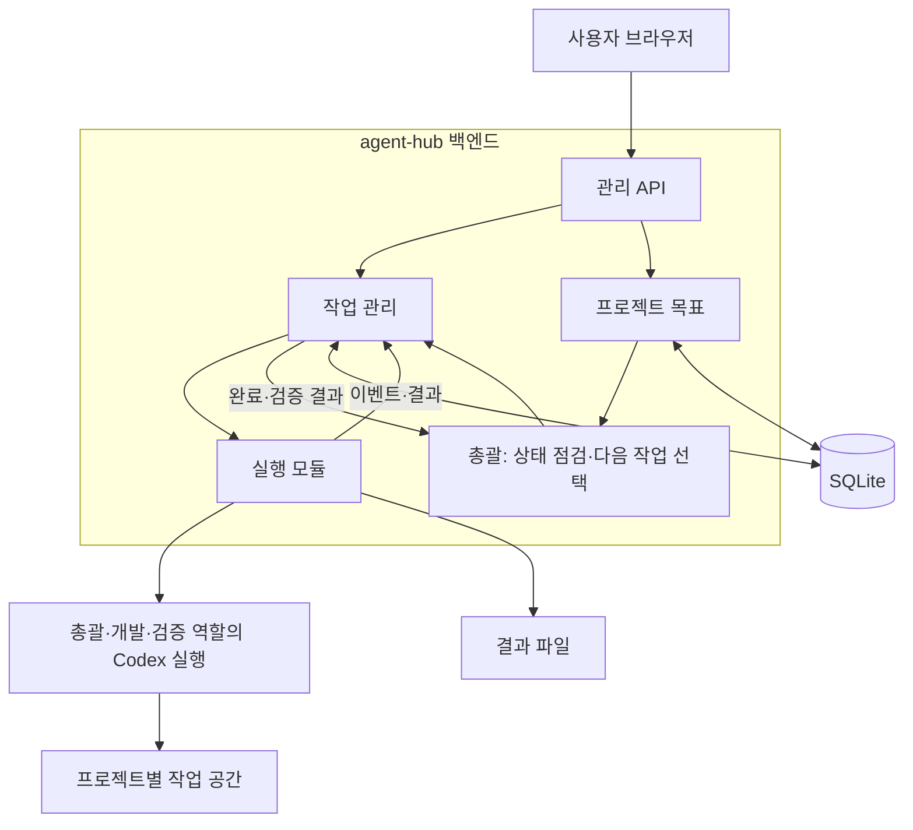

# agent-hub

여러 프로젝트의 목표를 맡기면, AI 에이전트들이 스스로 할 일을 찾고 개발·검증·개선을 이어가는 개인용 프로젝트 관리 시스템입니다.

사용자는 프로젝트별 목표·우선순위·허용 범위를 설정합니다. 총괄은 현재 코드와 작업 이력을 바탕으로 다음 작업을 만들고, 개발·검증 역할의 에이전트가 결과와 피드백을 주고받습니다. 작업이 끝나면 다음 작업을 선택하므로 매번 사용자의 새 지시가 필요하지 않습니다. 사용자는 진행 상황을 확인하고 목표를 바꾸거나 실행을 멈출 수 있습니다.

현재는 **설계 단계**입니다. 애플리케이션 코드, 실행 명령, 서버 배포는 아직 제공하지 않습니다.

## 문서를 읽는 순서

| 알고 싶은 내용 | 문서 | 이 문서에서 관리하는 내용 |
| --- | --- | --- |
| 무엇을 만드는가? | 이 README | 목적, 현재 상태, 첫 버전 범위 |
| 어떻게 동작하고 코드를 나누는가? | [01 구조와 작업 실행 규칙](docs/01-architecture.md) | 용어, 코드 연결, 작업 상태, 취소·복구·effort 규칙 |
| 무엇부터 만들고 어떻게 확인하는가? | [02 구현 순서와 완료 기준](docs/02-implementation-plan.md) | 개발 단계, 단계별 목표, 구현 범위와 검증 |
| 왜 이 기술과 구조를 골랐는가? | [03 초기 기술 선택과 대안](docs/03-technology-decisions.md) | 선택 이유, 대안, 단점과 재검토 조건 |

처음 읽을 때는 README를 보고 01의 용어·흐름부터 읽으면 됩니다. 구현할 때는 02에서 현재 단계를 찾고, 관련 동작은 01, 기술 선택은 03을 확인합니다. 요약과 상세 설명이 다르면 구현 전에 관련 문서를 맞춥니다.

## 첫 번째 목표

> 예제 앱에 “기본 학습 흐름을 완성하고 테스트로 검증해줘”라는 목표를 설정한다. 이후 사용자 입력 없이 미완성 기능을 찾아 작업으로 만들고, 개발·검증·필요한 재작업을 수행한 뒤 다음 작업으로 넘어간다. 관리 화면에서 선택 이유와 변경 결과를 확인할 수 있고, 서버를 재시작해도 이어서 처리한다.

여기서 첫 버전은 02 문서의 6단계까지 완성한 자율 운영 MVP를 뜻합니다. 1단계의 등록·조회와 2단계의 읽기 전용 분석은 연결을 검증하는 중간 단계입니다. 5단계에서 자율 작업 생성·개발·검증을 연결하고, 6단계에서 클라우드 무인 운영을 검증합니다.

| 범위 | 첫 버전의 기준 |
| --- | --- |
| 운영 규모 | 사용자 한 명, 서버 한 대, 백엔드 한 개, 동시 AI 작업 한 개 |
| 프로젝트 작업 | 목표에 따른 작업 자동 생성, 분리된 개발 작업 공간에서 코드 수정·테스트 |
| 에이전트 협업 | 총괄·개발·검증 역할이 기록을 주고받으며 순차 실행. 병렬 실행은 후속 확장 |
| 다음 작업 | 완료·검증 결과와 프로젝트 상태를 반영해 자동 선택. 주기적으로 새 변화도 확인 |
| 변경 결과 | 검증된 변경을 개발용 브랜치에 축적. 외부 푸시·기본 브랜치 병합·운영 배포는 별도 정책 |
| 진행 확인 | 현재 단계, 최근 활동·진척, 대기 사유와 다음 행동 표시 |
| 기존 서비스 관측 | 상태를 읽기만 하고 정상 동작·정상 대기·관측 실패를 구분 |
| 무인 복구 | 사용 한도 대기 후 자동 재개, 일시적 오류의 제한된 재시도 |
| 사용자 조치 | 사용자 취소는 자동 재시도하지 않으며, 인증 만료·복구 한도 초과는 보류·알림 |
| 추론 강도 | 다음 호출마다 `medium`·`high`·`xhigh` 중 선택. 최소·기본값은 `medium` |

24시간 운영의 핵심은 사용자 부재중에도 목표에 맞는 일을 발견하고 수행하는 반복 흐름입니다. 대기열이 비면 목표와 현재 상태를 다시 평가합니다. 할 일이 없거나 실행 예산이 부족하면 이유와 다음 점검 시각을 기록하고, 조건이 충족되면 자동으로 이어갑니다. 유한한 목표는 완료로 닫고, 지속 관리 목표는 정해진 주기로 점검합니다. effort는 단계 난이도에 따라 높이거나 낮추며 실제 지원 범위와 실행 예산은 백엔드가 확인합니다.

작업 관리와 실행은 같은 프로그램 안에서 나눕니다. 코드는 기능별로 모으고, 업무 규칙은 HTTP·DB·AI SDK 사용 코드에서 분리합니다. 단순한 기능에 불필요한 계층을 추가하지 않습니다. 작업 취소와 제한 시간은 해당 AI 실행에만 적용하며, 관측 중인 다른 서비스를 종료하지 않습니다.

## 기술 스택

| 영역 | 선택 | 역할 |
| --- | --- | --- |
| 언어 | TypeScript | 화면·서버·실행 프로그램의 데이터 형식 공유 |
| 관리 화면 | React + Vite | 프로젝트, 작업 목록, 진행 상황, 결과 표시 |
| 총괄 서버 | Node.js + Fastify | 인증, 작업 등록·배정, 상태·결과 저장 |
| 내부 실행 모듈 | Node.js + Codex SDK | 프로젝트 준비, 에이전트 실행, 결과 기록 |
| 데이터 저장 | SQLite | 프로젝트 설정, 작업, 실행 이력, 이벤트 저장 |
| 테스트 | Vitest + Playwright | 상태 전이와 주요 사용자 흐름 검증 |
| 배포 | Docker Compose | 서비스 실행 환경과 영속 저장소 구성 |

초기 개발 환경 선택안은 Node.js 24 LTS, pnpm, better-sqlite3와 Drizzle ORM·Kit입니다. [대안 비교와 선택 이유](docs/03-technology-decisions.md)를 기록하며, 정확한 의존성 버전과 잠금 파일은 첫 실행 골격에서 호환성을 검증한 뒤 고정합니다.

## 구성

첫 배포에서는 빌드한 관리 화면과 API를 같은 백엔드에서 제공합니다. 내부 모듈끼리는 함수 호출로 연결하며 별도 HTTP 통신을 만들지 않습니다. AI 모델 연산은 외부 서비스에서 수행하고, 코드 읽기·명령 실행 등은 서버의 Codex 실행 환경에서 수행합니다. 여러 서버가 필요해지면 실행 모듈을 별도 프로그램으로 분리합니다.

## 문서와 구현 상태

현재 문서의 “수행한다”, “검증한다”는 구현할 동작을 뜻하며, 이미 동작하거나 테스트를 통과했다는 뜻이 아닙니다. 초기 수치와 세부 정책은 설계 기본안입니다. 구현과 측정 결과에 따라 변경하고, 변경 이유를 해당 문서에 기록합니다.

## 공개 저장소와 실제 운영 데이터

이 저장소에는 프로그램 코드, 설계 문서, 가상 설정 예시를 보관합니다. 실제 프로젝트 소스, 서버 접속 정보, 인증 정보, 작업 DB, 실행 로그, 에이전트 대화와 결과 파일은 별도 비공개 저장소에 둡니다.

공개 저장소라는 사실이 관리 화면이나 실행 API의 공개 접근을 의미하지 않습니다. 원격 운영 전 사용자 인증과 HTTPS를 적용합니다. 실행 프로그램을 서버 밖으로 분리하는 단계에서는 프로그램 간 인증도 추가합니다. 개인 계정으로 인증한 에이전트 실행을 공개 PR의 CI에서 호출하지 않습니다.

소스 저장소 공개와 프로그램의 운영 배포는 별도 단계입니다. 공개 재사용을 허용할 라이선스는 별도로 선택합니다.

## 공식 참고 문서

- [Codex SDK](https://learn.chatgpt.com/docs/codex-sdk)
- [Codex 비대화형 실행과 인증](https://learn.chatgpt.com/docs/non-interactive-mode)
- [Fastify TypeScript](https://fastify.dev/docs/latest/Reference/TypeScript/)
- [Vite 시작하기](https://vite.dev/guide/)
- [SQLite WAL](https://www.sqlite.org/wal.html)
