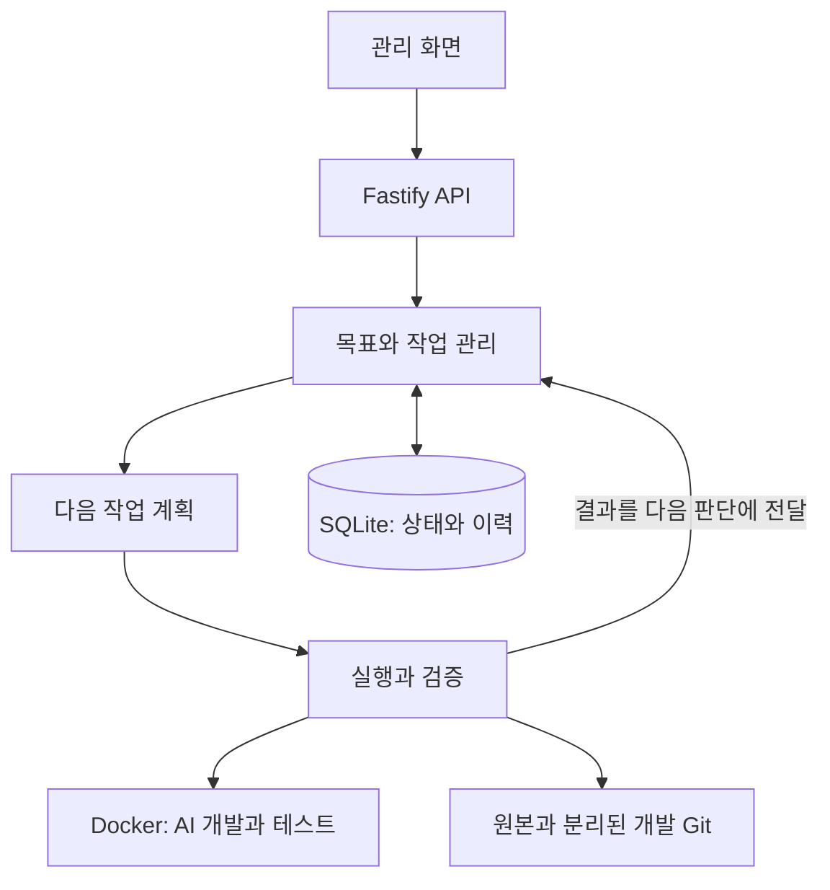

# 구조와 동작 요약

agent-hub는 **프로젝트의 목표를 작은 작업으로 나누고, 검증한 결과를 다음 작업에 이어주는 서버**입니다. AI가 작업 내용을 판단하고, 일반 프로그램 코드가 실행 순서·권한·예산·취소를 관리합니다.

현재 구현 여부는 [진행 상태](02-implementation-plan.md), 정확한 예외 처리와 API는 [상세 규칙](README.md#코드를-구현하거나-검토할-때)을 따릅니다.

## 먼저 알아둘 네 가지

| 이름 | 뜻 | 학습 앱 예시 |
| --- | --- | --- |
| **Goal — 목표** | 프로젝트에 맡긴 방향과 완료 기준 | 복습 기능을 완성하고 테스트로 확인 |
| **Task — 작업** | 목표를 위해 해결할 일 하나 | 복습할 단어를 고르는 기능 구현 |
| **Run — 실행 시도** | 작업을 한 번 실행한 기록 | 첫 시도는 연결 오류, 두 번째 시도는 성공 |
| **Step — AI 호출 단계** | 한 실행 안에서 AI를 호출한 단계 | 코드 파악, 개발, 독립 검토 |

재시도하면 같은 Task에 새 Run이 생깁니다. 한 Run 안에서 AI를 여러 번 호출하면 Step이 늘어납니다. 이름은 코드와 DB에서 같은 개념을 찾기 위한 표기입니다.

## 목표를 맡긴 뒤의 흐름

1. 사용자가 프로젝트와 목표, 바꿔도 되는 파일, 실행 예산을 정합니다.
2. 총괄 역할이 코드·이력·서비스 관측을 읽고 다음 작업을 제안합니다.
3. 서버가 중복·허용 범위·예산을 검사한 뒤 작업을 실행합니다.
4. 개발 역할이 원본과 분리된 공간에서 수정합니다.
5. 실제 테스트와 별도 AI 검토가 같은 코드 변경을 확인합니다. 문제가 있으면 정한 횟수 안에서 수정합니다.
6. 통과한 변경을 개발용 Git에 반영하고, 다음 작업은 그 코드를 기준으로 시작합니다.
7. 남은 목표를 다시 살펴봅니다. 유한 목표는 검증 후 완료하고, 지속 관리 목표는 다음 점검을 예약합니다.

이 흐름에는 작업마다 새 사용자 지시가 필요하지 않습니다. 단, 사용자가 등록한 Goal 없는 단발 분석이 임의로 새 목표를 만들지는 않습니다.

## 에이전트끼리 어떻게 협업하나

총괄은 **무엇을 할지**, 개발은 **어떻게 고칠지**, 검토는 **기준을 충족했는지**를 판단합니다. 같은 모델을 사용할 수 있지만 호출과 대화 맥락을 나눕니다.

역할 사이에는 작업 지시뿐 아니라 코드 버전·변경 내용·실제 테스트 결과·검토 의견을 전달합니다. AI가 “완료했다”고 말한 것만으로 성공 처리하지 않습니다. 역할별 고정 gstack 지침과 실제로 읽은 기록도 보존합니다.

현재는 서버 전체에서 Run 하나를 실행합니다. 여러 역할의 순차 협업과 여러 작업의 병렬 실행은 다릅니다.

## 서버에는 무엇이 있나

초기에는 하나의 Node 프로그램으로 배포합니다. DB·HTTP·Codex를 사용하는 코드와 작업 규칙을 분리하되, 모든 기능에 같은 계층이나 인터페이스를 만들지는 않습니다. [파일 구성과 코드 예시](reference/code-and-runtime.md#코드를-나누고-연결하는-기준)를 참고합니다.

## 무엇을 기다리고 언제 멈추나

| 상황 | 처리 원칙 |
| --- | --- |
| 할 일이 없음 | 이유와 다음 점검 시각을 기록하고 대기 |
| 계정 사용 한도·기간 예산 소진 | 제한을 보존하고 허용된 시점·횟수 안에서 다시 확인 |
| 일시적인 오류 | 자동 복구가 켜져 있으면 정해진 상한 안에서 재시도 |
| 사용자 취소·허용 범위 축소 | 중단 요청을 먼저 저장하고 실제 실행 종료 확인 |
| 이전 실행이 끝났는지 모름 | 충돌할 수 있는 새 실행을 시작하지 않음 |
| 인증 만료·복구 한도 초과 | 조치가 필요한 보류로 유지. 외부 알림은 다음 구현 범위 |

“중단 신호를 보냈다”와 “실행이 실제로 끝났다”를 구분합니다. 서버를 다시 켜도 저장된 종료 근거와 Git 반영 상태를 대조한 뒤 이어갑니다.

## 바뀌면 안 되는 기준

- 검증된 변경을 다음 작업에 전달합니다. 테스트·검토·반영 여부가 불명확하면 성공으로 바꾸지 않습니다.
- 취소한 작업을 이름만 바꿔 다시 만들거나, 새 Task로 누적 제한을 초기화하지 않습니다.
- 관측 중인 실제 서비스는 읽기만 합니다. agent-hub의 작업 취소가 그 서비스를 종료하지 않습니다.
- 원본 프로젝트·인증·작업 DB를 AI의 수정 공간과 분리합니다.
- 개발 코드에 반영하는 것과 원격 푸시·병합·운영 배포는 별도 정책입니다.

## 구현할 때 찾아볼 곳

| 주제 | 상세 문서 |
| --- | --- |
| 목표 변경, 계획 중복, 예산, 개발·검증·변경 반영 | [자율 개발](reference/autonomy.md) |
| API와 상태, 재시도, 취소, 종료 확인, 인증 | [작업 실행과 복구](reference/execution.md) |
| 폴더 구성, 내부·외부 코드 연결, 인증 환경, effort | [코드와 실행 환경](reference/code-and-runtime.md) |
| Linux 실행, HTTPS, 상태 보존, 백업·복원 | [운영 절차](04-operations.md) |
