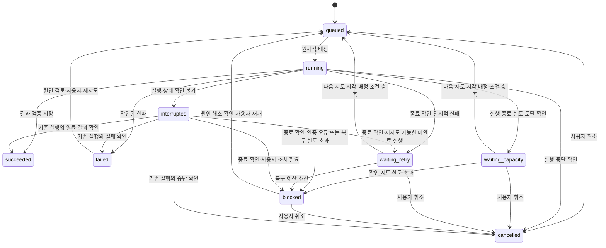

# 구조와 작업 실행 규칙

> 이 문서는 **프로그램이 어떻게 동작해야 하는지**를 정합니다. 현재는 설계이며, 아래 규칙을 만족하는 코드는 아직 구현하지 않았습니다.

처음 읽을 때는 [용어](#문서에서-쓰는-용어) → [작업 흐름](#작업-하나의-전체-흐름) → [코드 구성](#코드를-나누고-연결하는-기준) 순서로 보면 됩니다. 구현 중에는 [상태](#작업-상태), [복구](#배정과-복구), [취소](#취소와-제한-시간), [effort](#단계별-추론-강도-자동-선택)를 참조합니다. 구현 시점은 [02](02-implementation-plan.md), 기술 선택 이유는 [03](03-technology-decisions.md)에서 관리합니다.

첫 버전은 서버 한 대에서 agent-hub 백엔드 하나를 실행합니다. 백엔드 내부의 작업 관리 모듈이 상태를 관리하고, 실행 모듈이 제한된 작업 공간에서 Codex를 호출합니다. AI는 작업 내용을 판단하지만, 배정·시간 제한·취소·복구 규칙은 일반 프로그램 코드가 집행합니다. 별도 실행 서버는 후속 확장 사항입니다.

## 문서에서 쓰는 용어

| 용어 | 쉬운 설명 | 예시 또는 구분 |
| --- | --- | --- |
| 업무 규칙 | 프로그램이 지켜야 하는 판단 기준 | 사용자 취소는 자동 재시도하지 않음 |
| 처리 절차(유스케이스) | 규칙을 적용해 기능을 수행하는 순서 | 작업 조회 → 취소 요청 기록 → 실행 중단 요청 |
| 포트 | 내부와 외부 사이에 필요한 기능을 정한 인터페이스 | 작업 저장 기능, 에이전트 실행 기능 |
| 어댑터 | 특정 기술로 요청을 받거나 기능을 수행하는 연결 코드 | HTTP 요청 처리, SQLite 저장, Codex 호출 |
| 코드 의존성 | 한 코드가 다른 코드의 타입·함수를 가져다 쓰는 관계 | 작업 규칙은 Drizzle·Codex SDK를 직접 가져오지 않음 |
| Task | 사용자가 요청한 목표 | 프로젝트 구조를 분석해 달라는 요청 |
| Run | 그 목표를 실행하는 한 번의 시도 | 장애 후 재시도하면 새 Run |
| Step | 한 Run 안의 순차적 AI 호출 단계 | 구조 파악 → 원인 분석 → 결과 요약 |
| 트랜잭션 | 여러 DB 변경을 함께 저장하거나 함께 되돌리는 처리 | 작업 상태 변경과 Run 생성 |
| effort | AI 호출에 적용할 추론 강도 | 이 프로젝트는 medium·high·xhigh 범위 |
| worker | 후속 단계에서 별도 프로그램으로 분리할 실행 기능 | 초기에는 백엔드 내부 실행 모듈 사용 |

포트는 모든 인터페이스를 가리키는 말이 아니며, 외부와의 연결 역할을 하는 인터페이스를 뜻합니다. 외부 기능을 수행하는 어댑터는 포트를 구현하고, HTTP 요청을 받는 어댑터는 내부 기능을 호출할 수도 있습니다.

## 작업 하나의 전체 흐름

1. 사용자가 프로젝트와 목표를 등록하면 Task를 DB에 저장하고 응답합니다.
2. 실행 모듈이 실행 가능한 작업 하나를 선택하고 Run을 만듭니다.
3. 필요한 Step을 순서대로 실행하며 진행 상황과 결과를 기록합니다.
4. 결과를 검증하고 저장한 뒤 Task를 성공으로 표시합니다.
5. 오류·취소·서버 중단이 발생하면 아래 상태·복구 규칙에 따라 실패, 보류, 취소 또는 재시도를 결정합니다.

예를 들어 `Task: 프로젝트 분석` 아래에 `Run 1: 중단`, `Run 2: 재시도`가 남을 수 있습니다. Run 2 안에서 분석과 요약을 다른 effort로 수행해도 Step만 바뀌며 새 Run이 생기지는 않습니다.

## 저장소 구성안

```text
agent-hub/
├─ apps/
│  ├─ web/          # React 관리 화면
│  └─ server/       # Fastify API와 작업 관리
│     ├─ src/
│     │  ├─ main.ts      # 설정 로딩·시작·종료
│     │  ├─ app.ts       # DB·업무 기능·HTTP 라우트 연결
│     │  ├─ config.ts    # 환경 설정 검증
│     │  ├─ db/          # DB 연결·테이블·제약 정의
│     │  ├─ modules/
│     │  │  ├─ health/
│     │  │  ├─ projects/
│     │  │  └─ tasks/
│     │  └─ execution/   # 2단계부터 내부 실행 루프·어댑터
│     ├─ migrations/    # 검토한 SQL과 마이그레이션 메타데이터
│     └─ tests/         # API·DB 통합 테스트
├─ packages/
│  └─ contracts/    # 요청·응답 스키마와 공통 타입
├─ docs/
├─ .env.example
└─ README.md
```

위 구조는 구현 시 생성합니다. 공유 코드는 API 계약부터 시작하고, 서버의 DB 코드나 에이전트 인증 정보를 화면 패키지에서 가져오지 않습니다. TypeScript 타입 검사와 별개로 API 입력·SDK 출력에 런타임 검증을 적용합니다.

## 코드를 나누고 연결하는 기준

프로그램 하나 안에서 프로젝트 관리, 작업 관리, 실행 기능을 나눕니다. 각 기능 안에서는 작업 등록·취소·재시도처럼 실제로 하는 일에 따라 관련 코드를 모읍니다. 이렇게 변경할 기능을 중심으로 코드를 구성하는 방식을 Vertical Slice라고 합니다.

여러 기능이 함께 지켜야 하는 규칙은 한곳에 둡니다. 예를 들어 “취소한 작업을 자동으로 다시 실행하지 않는다”는 규칙을 등록·취소·복구 코드에 각각 복사하지 않습니다. DB에 저장하거나 Codex를 호출하는 코드는 별도로 두어, 사용하는 도구를 바꿀 때 업무 규칙까지 고치지 않도록 합니다. 단순한 기능은 작은 함수로 유지합니다. [대안과 선택 이유](03-technology-decisions.md#애플리케이션-구조)도 함께 기록합니다.

작업 모듈의 구성 예시는 다음과 같습니다. 취소·재시도 파일은 해당 기능 구현 단계에 추가합니다.

```text
modules/tasks/
├─ create-task.ts             # 작업 등록 절차
├─ cancel-task.ts             # 취소 절차
├─ retry-task.ts              # 재시도 절차
├─ task-state.ts              # 공통 상태 전이 규칙
├─ task-store.ts              # 업무에 필요한 저장 기능의 인터페이스
├─ routes.ts                  # HTTP 요청 검증·응답 매핑
└─ drizzle-task-store.ts      # 실제 DB 접근·원자적 저장
```

단순 조회는 작은 조회 함수로 유지하고, 상태를 변경하는 기능은 공통 상태 전이 규칙을 사용합니다. 기능별 파일에 취소·복구 조건을 복사하지 않습니다. 처음부터 파일마다 인터페이스와 클래스를 만들지 않으며, 함수와 명시적인 의존성 전달로 시작합니다. 기능이 커지면 관련 파일을 하위 폴더로 묶습니다.

### 외부 기술과 분리한다는 뜻

작업 등록 절차에 Drizzle의 조회·저장 코드를 직접 넣으면, 저장 기술을 바꿀 때 등록 절차도 수정해야 합니다. 대신 등록 절차는 “작업을 저장한다”는 인터페이스를 사용하고, 실제 Drizzle 호출은 연결 코드에 둡니다.

```text
create-task.ts           → TaskStore 인터페이스를 사용
drizzle-task-store.ts    → 같은 인터페이스를 구현하고 Drizzle을 호출
app.ts                  → 실제 저장 구현을 작업 등록 기능에 전달
```

위 화살표는 코드가 무엇을 참조하는지 나타냅니다. 실행할 때는 등록 기능이 전달받은 저장 구현을 호출합니다. 저장 기술과 분리한다는 것은 DB를 쓰지 않는다는 뜻이 아니라, 업무 코드가 DB 라이브러리의 사용법을 직접 몰라도 되게 한다는 뜻입니다. 구현체를 바꾸더라도 결과·오류·트랜잭션 약속이 유지되는지 검증해야 합니다.

| 코드의 역할 | 사용하는 것 | 지켜야 할 기준 |
| --- | --- | --- |
| 상태 변경·재시도·effort 판단 | 작업 정보, 현재 시각 등 전달받은 값 | 서버·DB·AI를 실행하지 않아도 판단하고 테스트할 수 있게 함 |
| 등록·취소·배정 절차 | 공통 규칙과 저장·실행 기능 | Fastify 요청 객체나 Drizzle 객체를 직접 사용하지 않음 |
| HTTP 요청 처리 | 요청·응답 형식과 등록·조회 등의 기능 | 입력을 확인하고 결과를 응답하며, 업무 규칙이나 SQL은 직접 작성하지 않음 |
| DB·Codex 연결 코드(어댑터) | 저장·실행에 필요한 약속과 해당 라이브러리 | 외부 도구의 결과·오류를 프로그램 내부 형식으로 변환 |
| `app.ts` 등 구성 코드 | 실제 DB·서비스·요청 처리 코드 | 사용할 구현을 만들어 연결하고, 업무 규칙은 다른 코드에 둠 |

기능끼리는 외부에서 호출할 수 있도록 정한 함수와 데이터 형식으로 연결합니다. 작업 관리 코드가 프로젝트 관리 코드의 내부 DB 처리에 직접 접근하지 않게 합니다. 화면과 서버는 `contracts`에 정의한 요청·응답 형식을 공유하고, 화면에서 서버의 업무 규칙·DB 코드를 가져오지 않습니다. DB에 저장된 모든 필드를 그대로 응답하지 않고 화면에 필요한 필드만 정합니다.

DDD의 관점은 Task·Run·Step의 의미를 통일하고 항상 지켜야 할 규칙을 정리하는 데 사용합니다. 이를 위해 모든 테이블을 복잡한 객체 구조로 감쌀 필요는 없습니다. 읽기·쓰기를 별도 모델로 나누는 CQRS, 사건 기록으로 현재 상태를 복원하는 이벤트 소싱, 기능 사이의 사건을 전달하는 이벤트 버스는 초기 필수 구성에 넣지 않습니다. 실행 이력인 Event를 저장하는 것만으로 이벤트 소싱을 사용하는 것은 아닙니다.

### 함께 저장할 데이터와 테스트 방법

작업을 배정할 때는 대기 작업을 고르고, 상태를 실행 중으로 바꾸고, 실행 기록인 Run을 만들어야 합니다. 상태만 바뀌고 Run이 없는 일이 생기지 않도록 이 변경들을 하나의 DB 트랜잭션으로 처리합니다. 모두 성공하면 저장하고, 하나라도 실패하면 함께 되돌립니다. 저장 기능을 요청하는 인터페이스에도 이 조건을 명시합니다. 저장 함수를 순서대로 호출하는 것만으로는 이 조건이 보장되지 않습니다.

같은 등록 요청으로 작업이 두 개 생기지 않도록 DB에도 중복 방지 조건을 둡니다. DB 트랜잭션은 짧게 끝내고, AI 호출이나 외부 응답을 기다리는 동안 유지하지 않습니다.

상태 변경·재시도·effort 판단은 DB와 AI 없이 테스트합니다. 실제 데이터 저장, 중복 방지, 테이블 변경은 SQLite를 연결해 검증합니다. API에서는 잘못된 입력의 거부, 응답 내용과 실제 저장 결과를 확인합니다. Codex 연결은 이벤트·오류를 변환하는 테스트와 실제 호출 검증을 나눕니다. 가짜 저장소만으로 실제 DB의 동작까지 검증했다고 보지 않습니다. 코드가 다른 기능의 내부 파일을 직접 가져오지 않는지도 확인합니다.

## 각 구성 요소의 책임

| 구성 요소 | 책임 | 다른 구성 요소에 맡기는 일 |
| --- | --- | --- |
| 관리 화면 | 지시 입력, 상태·결과 표시, 취소 요청 | 에이전트 인증과 직접 실행 |
| 총괄 서버 | 인증, 입력 검증, 작업 배정, 상태 전이, DB 기록 | 빌드·분석·테스트 실행 |
| 내부 실행 모듈 | 작업 공간 준비, 실행 감시, 이벤트·결과 반환 | 사용자 인증과 최종 상태의 임의 변경 |
| Codex 어댑터 | SDK 실행·이벤트·오류를 공통 형식으로 변환 | 작업 재배정과 서비스 운영 정책 |
| SQLite | 프로젝트·작업·실행·이벤트 메타데이터 보존 | 대용량 원문 로그와 결과 파일 저장 |

처음에는 Codex 어댑터 하나를 만듭니다. 추후 다른 제공자를 추가할 수 있게 실행 부분을 분리하되, 모든 제공자 기능을 미리 일반화하지 않습니다.

2단계에서 실행 인터페이스와 Codex 어댑터를 추가합니다. 업무 코드는 제공자와 상관없이 사용할 실행 요청·이벤트·종료 결과 형식을 사용합니다.

- 인증, 대화 세션, 취소, 사용 한도, effort는 제공자마다 다를 수 있으므로 어댑터와 지원 기능 정보로 처리합니다.
- 지원하지 않는 옵션은 조용히 무시하지 않고 처리할 수 없는 이유를 남깁니다.
- Claude 등으로 교체할 때는 새 연결 구현과 동일한 완료 기준의 검증이 필요합니다. SDK만 바꾸면 결과 품질과 취소 동작도 같아진다고 보장하지 않습니다.

## 배치와 통신

초기에는 하나의 백엔드가 관리 화면·API와 작업 실행을 담당합니다. 개발 중에는 로컬 HTTP를 사용하고, 인터넷에서 접속하는 배포에는 Caddy 같은 웹 서버를 앞에 두어 HTTPS를 적용합니다. 백엔드 내부의 작업 관리와 실행 모듈은 함수 호출로 연결합니다.

작업 등록 API는 DB에 작업을 저장한 뒤 응답하며, AI 작업 완료까지 HTTP 요청을 열어두지 않습니다. 내부 실행 루프가 대기 작업을 하나씩 처리합니다. SDK와 외부 명령은 비동기로 감시하며 CPU가 많이 필요한 계산을 요청 처리 흐름에서 직접 수행하지 않습니다. Codex와 테스트 도구가 자식 프로세스로 실행되는 것은 별도 agent-hub 서비스를 운영하는 것과 구분합니다.

작업 부하 때문에 여러 서버가 필요해지면 실행 모듈을 worker 프로그램으로 분리합니다. 그 단계에서 worker가 HTTPS로 작업을 가져오고 결과를 보고하도록 API와 프로그램 간 인증을 추가합니다. 기존 장기 실행 서비스와 자원을 공유할지는 실제 사용량을 측정해 결정합니다.

초기 관리 화면은 주기적인 상태 조회를 사용합니다. 이벤트 실시간 전송이 필요해지면 SSE를 추가합니다. 연결 단절 후에는 마지막 이벤트 순번 이후를 조회할 수 있도록 저장 이벤트에 순번을 부여합니다.

SQLite 파일은 총괄 서버의 로컬 영속 볼륨에 둡니다. 실행 프로그램이 DB 파일을 네트워크로 공유하거나 직접 수정하지 않습니다. WAL과 짧은 쓰기 트랜잭션을 사용하고, 백업은 SQLite 백업 기능 등 일관성을 보장하는 방식으로 수행합니다.

## 작업과 실행 시도 구분

사용자가 요청한 목표는 `Task`, 그 목표를 실행한 각 시도는 `Run`으로 구분합니다. 재시도할 때 이전 실행 기록을 덮어쓰지 않습니다.

하나의 Run은 여러 순차적 AI 호출 단계(`Step`)로 구성할 수 있습니다. 정상적인 단계 전환이나 effort 변경은 재시도가 아니므로 새 Run을 만들지 않습니다. Step별 세션과 결과를 기록하고 다음 호출에 필요한 맥락을 전달합니다.

| 데이터 | 주요 필드 |
| --- | --- |
| Project | ID, 표시 이름, 작업 공간 식별자, 허용 정책, 생성 시각 |
| Task | ID, 프로젝트 ID, 지시, 상태, 등록 요청 키, 제한 시간, 취소 요청 시각, 재시도 정책, 재시도 횟수, 다음 시도 시각, 누적 실행 시간, 보류 사유 |
| Run | ID, 작업 ID, 앱 실행 인스턴스 ID, SDK 세션 ID, 시작·종료 시각, 현재 단계, 최근 이벤트·진척 시각, 대기 사유, 다음 행동, 종료 사유 |
| Step | ID, 실행 ID, 순번, 단계 목적, 상태, 모델·SDK 세션 ID, 제안·적용 effort, 선택 근거·정책 버전, 시작·종료 시각, 제공된 사용량, 결과·근거 참조 |
| Event | 실행 ID, 순번, 종류, 비밀 정보 제거 후 메시지, 시각 |
| Artifact | 실행 ID, 저장 위치 식별자, 종류, 크기, 체크섬 |
| ProviderGate | 제공자·계정의 비공개 식별자, 차단 범위·사유, 다음 시도 시각, 확인 시도 횟수, 확인 실행 ID |
| ServiceTarget | ID, 프로젝트 ID, 표시 이름, 비공개 연결 설정 식별자, 관측 주기, 정상 동작 기준 |
| ServiceObservation | 대상 ID, 관측·수신 시각, 수집 성공 여부, 프로세스·업무 상태, 최근 업무 처리 시각, 근거와 오류 요약 |

프로젝트 작업 공간 식별자는 비공개 설정에서 실제 경로로 변환합니다. 사용자 입력을 그대로 셸 명령에 보간하지 않고 실행 파일과 인자 배열을 분리합니다. worker 분리 단계에서 실행 프로그램 ID, 실행 권한 토큰과 만료 시각을 추가합니다.

이전 작업을 참고할 때는 관련 Task·Run·검증 결과와 당시 코드 버전을 조회해 필요한 내용만 에이전트에게 전달합니다. 기록 저장만으로 모델이 자동으로 기억하는 것은 아니며, 이전 결과가 현재 코드에도 유효한지 다시 확인합니다.

## 작업 상태

상태 이름은 DB·API·화면에서 같은 의미로 사용합니다. `interrupted`는 실행 결과를 확인할 수 없다는 뜻이고, `blocked`는 사용자 조치가 필요하다는 뜻입니다. 둘을 단순한 실패로 합치지 않습니다.

| 상태 | 의미 |
| --- | --- |
| queued | 배정을 기다림 |
| running | 현재 실행 시도에서 작업 중 |
| waiting_capacity | 제공자 사용 한도 등으로 실행을 보류함 |
| waiting_retry | 종료가 확인된 일시적 실패 이후 다음 시도 시각을 기다림 |
| blocked | 인증 복구나 재시도 한도 검토 등 사용자 조치가 필요함 |
| interrupted | 연결 단절·재시작 등으로 실제 종료 결과가 불명확함 |
| succeeded | 결과 검증과 저장이 완료됨 |
| failed | 실행 실패가 확인되고 종료 사유가 저장됨 |
| cancelled | 실행 전 취소됐거나 실행 중단이 확인됨 |



무인 운영에서 매번 사용자 입력을 기다리는 병목을 없애기 위해 자동 복구를 클라우드 MVP의 필수 범위로 둡니다. 2·3단계의 로컬 검증에서는 수동 재개로 시작하고, 4단계에서 아래 자동 정책을 완성합니다. 재개는 같은 Task에 새 Run을 만드는 것이며 이전 실행 기록을 덮어쓰거나 중간 지점부터의 실행을 보장하지 않습니다.

### 무인 운영의 자동 복구 정책

| 상황 | 처리 |
| --- | --- |
| 사용 한도 도달 | 기존 실행 종료 확인 후 `waiting_capacity`로 보류하고 제공자가 알려준 재시도 가능 시각 이후 제한적으로 재시도 |
| 한도 회복 시각 미제공 | 회복 여부를 미확인으로 표시하고 간격을 늘려 제한적으로 재시도 |
| 일시적 네트워크·서비스 오류 | 실행 종료 확인 후 `waiting_retry`에서 대기하고 정책 범위 안에서 재시도 |
| 서버 재시작 | 기존 실행·결과를 대조하고 완료 결과를 복구하거나, 종료가 확인된 재시도 가능한 미완료 실행을 `waiting_retry`로 전환 |
| 실행 종료 여부 불명확 | `interrupted`를 유지하고 재확인·알림, 충돌 가능 실행은 배정하지 않음 |
| 인증 만료·복구 한도 초과 | 종료 확인 후 `blocked`로 보류하고 필요한 조치를 알림 |
| 재시도 불가능한 오류·실행 제한 시간 초과 | 종료 확인 후 `failed`로 기록하고 자동 재시도하지 않음 |
| 사용자 취소 | 중단 확인 후 `cancelled`, 자동 재시도하지 않음 |

### 재시도를 멈추거나 기다리는 기준

- 최초·최대 대기 간격, 작은 무작위 지연, 최대 자동 재시도 횟수, Task 누적 실행 시간 상한을 설정합니다.
- 사용 한도 확인과 일시적 오류의 정책을 구분하고, 같은 오류가 연속으로 발생하는 횟수도 제한합니다. 정확한 기본 수치는 4단계에서 고정하고 검증합니다.
- 횟수, 다음 시도 시각, 누적 시간, 계정별 차단 상태를 DB에 저장합니다. 서버를 재시작해도 초기화하지 않습니다.
- 제공자가 알려준 재시도 가능 시각보다 먼저 호출하지 않습니다. 그 시각이 지났더라도 한도가 실제로 회복됐는지는 재확인이 필요합니다.

### 같은 계정을 쓰는 다른 작업의 처리

`ProviderGate`는 제공자·계정별로 새 실행을 막아야 하는지 관리하는 기록입니다. 같은 계정의 한도에 걸렸을 때 프로젝트를 바꿔 호출을 반복하지 않도록 합니다.

1. 한도에 걸린 계정으로는 다른 프로젝트도 새 실행을 시작하지 못하게 합니다. 한도 범위가 불명확하면 같은 계정 전체에 적용하고 근거를 남깁니다.
2. 재시도 시각에 확인 실행 하나만 허용합니다. 성공이 확인되면 차단을 해제하고, 다시 한도 오류가 나면 다음 시각을 갱신합니다.
3. 인증 만료도 해당 계정의 배정을 막습니다. 사용자가 재개를 요청해도 계정 차단과 기존 실행 종료 확인을 우회하지 않습니다.

배정할 때 보류 작업은 건너뛰고 실행 가능한 작업을 선택합니다. 단, 첫 버전의 동시 실행 수는 하나입니다. 이전 실행의 종료 여부가 불명확하면 새 AI 실행 전체를 보류하고 서비스 관측·상태 조회·복구 확인만 계속합니다. 알림 전송이 실패해도 이를 별도로 기록하고 다른 작업이나 복구 판단을 멈추지 않습니다.

## 진행 상황과 서비스 상태 관측

`running`이라는 저장 상태만으로 작업이 정상 진행 중이라고 판단하지 않습니다. 작업 상태와 별도로 관측 결과를 보여주고, 언제 확인한 정보인지 함께 표시합니다.

| 확인할 내용 | 근거 | 화면 표시 예시 |
| --- | --- | --- |
| agent-hub 응답 여부 | 상태 확인 요청 응답, 관측 시각 | 정상 응답 / 접속 불가 |
| 실행 프로세스 생존 | 자식 프로세스 상태와 종료 이벤트 | 실행 중 / 종료 확인 / 확인 불가 |
| 실행 활동 | SDK 이벤트, 도구 실행 시작·완료 시각 | 파일 읽는 중 / 테스트 명령 실행 중 |
| 실제 진척 | 완료 단계, 검증 결과, 저장된 산출물 | 구조 분석 완료 / 테스트 결과 수집 완료 |
| 대기 이유 | 사용량 제한, 외부 응답 대기, 입력 필요 등 확인된 사유 | 사용 한도 회복 대기 |
| 관측 신선도 | 마지막 수집 성공 시각과 설정한 유효 기간 | 최신 정보 / 오래된 정보 / 미확인 |

로그가 계속 출력되거나 프로세스가 살아 있다는 사실만으로 진척이 있다고 표시하지 않습니다. 반대로 출력이 없다는 이유만으로 프로세스가 죽었다고 표시하지 않습니다. `last_event_at`과 `last_progress_at`을 구분하고, 무진척 경고에는 판단 근거와 경과 시간을 함께 표시합니다. 모델의 사고 내용을 추정해 보여주거나 근거 없는 완료율을 만들지 않습니다.

실행 화면에는 최소한 목표, 현재 단계, 경과 시간, 최근 활동, 최근 진척, 대기 사유, 다음 행동을 보여줍니다. 다음 행동은 실행 정책과 확인된 결과에서 결정하며, 예를 들어 `분석 완료 후 결과 저장`, `사용 한도 확인 후 재개`, `기존 실행 종료 확인 필요`처럼 표시합니다. 알 수 없으면 미확인으로 표시합니다. 대기 작업 목록의 다음 작업과 보류 사유도 조회할 수 있게 합니다.

### 기존 장기 실행 서비스 관측

장기 실행 서비스는 끝나는 작업인 Task·Run과 별도로 ServiceTarget으로 등록합니다. 초기에는 명시적으로 설정한 읽기 전용 상태 API 또는 제한된 관측 인터페이스 하나를 연결합니다. 실행 프로세스 상태와 실제 업무 처리 신호를 함께 확인합니다. 예를 들어 주기 처리 서비스는 최근 처리 성공 시각, 오류 수, 다음 실행 예정 시각을 제공할 수 있습니다.

서비스별 정상 대기 조건과 예상 처리 간격을 설정합니다. 처리할 입력이 없는 정상 대기와 장애를 구분하고, 필요한 신호가 없는 서비스는 판단 한계를 표시합니다. 조회 실패는 우선 `관측 실패·상태 미확인`이며, 대상 서비스의 종료가 확인된 경우에만 종료로 표시합니다. 마지막 정상 기록은 과거 관측으로 남기고 현재 정상인 것처럼 표시하지 않습니다.

초기 관측 기능은 상태·오류·최근 처리 시각을 표시합니다. 대상 서비스의 중지·재시작·설정 변경이나 자동 복구는 수행하지 않습니다. 실제 접속 주소와 인증 정보는 비공개 설정에 둡니다.

### agent-hub 자체의 장애 확인

브라우저는 상태 조회가 실패하면 기존 화면을 그대로 정상으로 유지하지 않고 연결 끊김과 마지막 확인 시각을 표시합니다. 서버가 응답해도 DB나 실행 준비 상태가 실패하면 기능 사용 불가를 구분해 보여줍니다.

agent-hub가 완전히 종료되면 스스로 장애를 보고할 수 없습니다. 배포 환경에서는 프로세스 관리자가 종료를 감지·재시작하고, 별도 위치의 상태 점검이 서버 전체의 접근 불가를 확인하도록 구성합니다. 외부 점검 실패만으로 프로세스 사망을 확정하지는 않습니다. 사용자 부재중 알림 채널과 수신 대상은 배포 시 별도로 설정합니다.

## 배정과 복구

### 초기 단일 애플리케이션

1. 대기 작업 선택, `running` 상태 변경, Run 생성을 짧은 트랜잭션으로 처리합니다. DB 제약으로 작업 하나에 활성 실행이 둘 생기지 않게 합니다.
2. 요청·결과 처리와 별도로 내부 실행 루프 하나가 작업을 수행합니다. 같은 DB를 사용하는 백엔드가 중복 기동하지 않도록 단일 실행을 강제합니다.
3. 이벤트와 결과를 Run ID에 연결해 저장합니다. 현재 Run과 다른 실행의 늦은 결과는 최종 상태를 덮어쓰지 못하게 합니다.
4. 정상 종료 시 새 배정을 중지하고 자식 실행의 종료를 확인합니다. 비정상 종료 후에는 남은 `running` 작업을 `interrupted`로 바꿉니다.
5. 재시작 시 이전 자식 프로세스가 남았는지 확인하고, 기존 실행 종료가 확인될 때까지 신규 실행을 보류합니다. 단순히 PID만으로 같은 프로세스라고 판단하지 않습니다. 종료 확인 후 자동 복구 정책에 따라 결과 수용·재시도·보류를 결정하며 취소 요청도 복원해 재시도를 차단합니다.

서버 자체가 멈춘 동안에는 화면을 제공하지 못하지만 작업 기록은 DB에 남습니다. 재시작 뒤 기록과 실제 실행 상태를 대조합니다.

### 후속 worker 분리 시 추가할 규칙

다음 생존 신호와 실행 권한 갱신은 원격 worker를 운영할 때 추가하며 초기 구현의 필수 항목은 아닙니다.

1. 총괄 서버는 짧은 DB 트랜잭션에서 대기 작업 선택, 상태 변경, Run 생성, 실행 권한 발급을 함께 처리합니다.
2. 실행 프로그램은 초기 기본값으로 10초마다 생존 신호를 보내고, 실행 권한 유효 기간은 60초로 둡니다. 이 수치는 실제 통신 지연에 따라 조정합니다.
3. 결과·이벤트 보고에는 Run ID와 실행 권한 토큰이 필요합니다. 만료되거나 교체된 권한의 보고는 정상 결과로 바로 반영하지 않습니다.
4. 생존 신호가 끊기면 작업을 `interrupted`로 표시합니다. 원격 프로세스가 계속 실행 중일 수 있으므로 곧바로 다른 실행 프로그램에 배정하지 않습니다.
5. 실행 프로그램은 권한 갱신에 실패한 상태가 만료 시각에 이르면 자식 실행 중단을 시도하고 상태를 로컬에 기록합니다. 재연결 시 현재 실행·종료 결과를 보고해 총괄 서버와 대조합니다.
6. 중단된 작업은 기존 실행이 종료됐는지 확인한 뒤 동일한 자동 복구 정책에 따라 결과 수용·재시도·보류를 결정합니다.

API 요청은 재전송될 수 있습니다. 등록 요청 키와 이벤트 순번에 중복 방지 제약을 두고, 종료 보고 재전송에도 상태가 뒤집히지 않도록 합니다. 이 설계가 외부 명령의 정확히 한 번 실행까지 보장하는 것은 아닙니다. 코드 변경 기능 추가 시에는 변경 상태를 확인한 뒤 복구하도록 확장합니다.

## 취소와 제한 시간

핵심 구분은 **취소 요청과 취소 완료가 다르다**는 것입니다. 중단을 요청한 기록을 먼저 남기고 실제 실행 종료를 확인합니다.

취소는 사용자가 잘못된 지시나 불필요한 실행을 멈추는 기능입니다. 제한 시간은 단일 작업이 실행 자원을 무기한 점유하는 것을 막는 상한이며, 프로젝트·작업 종류별로 설정합니다. 상시 실행 서비스에는 분석 작업의 제한 시간을 적용하지 않습니다.

전체 제한 시간과 무진척 경고를 구분합니다. 전체 제한 시간은 Run 실행 시작부터 계산하며 대기열에서 기다린 시간은 포함하지 않습니다. 무진척 경고는 단계별 예상 시간과 최근 관측을 기준으로 표시하고, 로그가 잠시 없다는 이유만으로 작업을 자동 종료하지 않습니다. 현재 제한과 마감 시각은 화면에 보여줍니다.

실행 중 취소는 `cancel_requested_at`으로 먼저 기록합니다. 실행 모듈은 SDK가 제공하는 중단 기능 또는 격리된 실행 프로세스 종료를 사용합니다. 제한 시간 초과에도 같은 중단 절차를 적용합니다.

중단이 확인되면 사용자 취소는 `cancelled`, 제한 시간 초과는 `failed`와 해당 종료 사유로 기록합니다. 확인되지 않으면 `interrupted`로 둡니다. SDK 중단 기능이 자식 명령까지 종료하는지는 실제 통합 단계에서 검증합니다.

취소 버튼을 누른 즉시 완료로 표시하지 않고 중단 요청 상태를 보여줍니다. 취소는 이미 발생한 파일 변경이나 외부 동작을 되돌리지 않습니다. agent-hub가 시작한 해당 Run의 실행만 중단하며, 관측 대상으로 등록한 다른 장기 실행 서비스를 종료하지 않습니다.

### 완료와 취소가 겹치는 경우

현재 Run과 Task 상태를 확인하는 DB 트랜잭션 안에서 아래 기준으로 최종 결과를 확정합니다.

| 확인된 사실 | 처리 |
| --- | --- |
| 이미 성공이 확정됨 | 성공 유지. 취소 요청으로 덮어쓰지 않음 |
| 중단되기 전에 정상 완료됨 | 결과 검증·저장 후 성공 처리 |
| 사용자 취소에 따른 실제 중단이 확인됨 | `cancelled`로 확정 |
| 완료인지 중단인지 확인할 수 없음 | `interrupted` 유지 |

취소 요청이 기록된 작업은 복구 중에도 자동 재시도하지 않습니다.

## 실행 환경과 인증

- Codex 계정 인증 정보는 서버의 비공개 인증 저장소에서 관리하고, 애플리케이션 DB·API 응답·프론트엔드 번들에는 넣지 않습니다. Codex 자식 실행에 필요한 접근만 제공하며 분석할 프로젝트에 인증 파일을 포함하지 않습니다.
- 구독 인증과 API 키 인증의 과금 방식을 구분하고, 선택한 방식을 운영 설정에 명시합니다. 실패했다고 유료 API 방식으로 자동 전환하지 않습니다.
- 첫 분석 작업은 정제된 프로젝트 사본 또는 지정 커밋을 읽기 전용으로 제공합니다. 운영 디렉터리·운영 DB·운영 서비스의 자격 증명은 제공하지 않습니다.
- Git 작업 공간 분리는 파일 충돌을 줄이지만 권한 격리를 대신하지 않습니다. 프로세스 권한, 파일시스템 마운트, 네트워크 접근은 별도로 제한합니다.
- 실행 프로그램에 호스트 Docker 소켓을 기본 제공하지 않습니다. 컨테이너·k8s 실험은 후속 단계에서 별도 실행 환경으로 설계합니다.
- 이벤트와 결과에 크기 제한을 두고 인증 문자열을 제거합니다. 원문 기록은 비공개 데이터로 취급하며 화면에서도 인증 후 조회합니다.

공개 CI는 비밀 정보 없는 테스트와 빌드만 실행합니다. 공개 저장소의 외부 PR이 개인 인증을 가진 실행 프로그램으로 작업을 보내는 경로는 만들지 않습니다.

## 단계별 추론 강도 자동 선택

작업 시작과 단계 전환 시 **다음 AI 호출에 적용할 effort**를 선택합니다. 실패가 없어도 복잡한 단계에서는 높이고, 단순한 단계에서는 낮춥니다. 사용자가 매번 설정할 필요가 없도록 만드는 기능입니다.

진행 중인 호출의 설정을 실시간으로 바꾸는 것은 전제하지 않습니다. 모델·SDK가 지원하는 설정은 연동할 때 확인합니다. 같은 대화 세션에서 변경할 수 없다면 새 세션에 필요한 맥락을 전달하고, 같은 Run 안의 다음 Step으로 기록합니다.

### 선택 범위와 예시

| 다음 단계의 성격 | 초기 선택안 |
| --- | --- |
| 짧은 요약·명확한 분류 | medium |
| 일반 프로젝트 분석·범위가 명확한 구현 | medium |
| 여러 모듈의 관계·동시성 문제·상충하는 가설 분석·중요 변경 검토 | high |
| 여러 시스템에 걸친 복잡한 인과 분석·특히 어려운 설계 판단 | xhigh |
| 생존 확인·배정·재시도 시각 계산 | AI를 호출하지 않고 코드로 처리 |

최소·기본값은 `medium`, 최대는 `xhigh`입니다. 이는 프로젝트의 허용 범위이며 Codex 전체 지원 목록이 아닙니다. 일반 단계는 medium으로 처리하고 어려운 단계에 더 많은 추론을 사용하기 위한 초기안입니다. 대표 작업의 품질·소요 시간·제공된 사용량을 측정해 조정합니다.

```text
구조 파악(medium)
→ 복잡한 원인 분석(high)
→ 여러 시스템의 상호작용 검토(xhigh)
→ 결과 요약(medium)
```

시작부터 난도가 높으면 high·xhigh를 바로 선택할 수 있습니다. 코드 수정 기능은 기존 후속 단계에서 구현합니다.

### 다음 호출의 설정을 결정하는 순서

1. 첫 호출은 작업 종류와 알려진 범위를 기준으로 선택합니다.
2. 단계 결과에서 다음 목적, 근거, 미해결 사항, 권장 effort와 이유를 읽습니다. 매번 별도 분류용 AI를 호출하지 않습니다.
3. 제안이 없거나 잘못됐으면 기본 정책을 사용합니다. 백엔드는 실제 지원 값, 프로젝트 허용 범위, 남은 실행 예산을 확인해 최종 설정을 정합니다.
4. 허용 범위와 지원 값이 겹치지 않으면 설정 조치가 필요한 상태로 보류합니다. 임의의 값으로 실행하지 않습니다.

실패는 재평가 근거 중 하나입니다. 논리적 문제는 상향을 검토하고, 자료 부족은 근거를 더 수집합니다. 네트워크 장애·사용 한도는 effort 상향 대신 자동 복구 정책으로 처리합니다. effort 변경만으로 진척이나 성공을 표시하지 않으며, 결과는 계속 검증합니다. 모델 변경은 별도 정책이고 effort 조정 때문에 자동으로 모델을 바꾸지 않습니다.

### 상한과 기록

- Step 수와 effort 변경 횟수에 상한을 둡니다. 단계가 바뀌어도 Run 제한 시간·Task 누적 실행 시간·재시도 예산을 초기화하지 않습니다.
- 재평가는 호출 경계에서만 수행하고, 권장 effort가 같으면 유지합니다. 모델이 자신의 허용 상한을 높일 수는 없습니다.
- 예산을 소진하면 기존 제한·보류 정책을 적용합니다. 단순히 effort만 낮춰 계속 실행하지 않습니다.
- 화면에 현재 effort와 선택 이유를 표시합니다. Step별 소요 시간, 검증 결과, 제공된 사용량을 기록합니다.
- 제공되지 않은 사용량이나 남은 구독 한도를 추정해 확정값으로 표시하지 않습니다.

설정 참고: [Codex Configuration Reference](https://learn.chatgpt.com/docs/config-file/config-reference). 지원 값과 호출별 적용 방법은 구현에 사용하는 모델·SDK 버전으로 검증합니다.

## 장기 협업과 개선

여러 에이전트는 작업 ID에 연결된 요청·응답·근거·결과를 교환합니다. 총괄은 횟수·시간·동시 실행 수를 제한하고, 검증 단계의 통과 조건을 확인합니다. 같은 실패를 반복하면 작업을 보류합니다.

처음부터 총괄의 모든 결정을 AI에 맡기지 않습니다. 예약과 배정은 코드로 실행하고, 작업 분해나 코드 판단처럼 해석이 필요한 단계에 에이전트를 사용합니다. 프로그램 자신의 권한·비용 한도·배포 규칙 변경은 일반 프로젝트 개선 작업에서 제외합니다.

## 기술 선택 이유와 전환 조건

Node.js 버전, 패키지 관리자, SQLite 드라이버와 DB 접근 방식의 초기 선택안·대안·단점·재검토 조건은 [초기 기술 선택과 대안](03-technology-decisions.md)에 기록합니다. 아래 표는 전체 구조에 대한 결정 요약입니다.

| 결정 | 현재 이유 | 다시 검토할 조건 |
| --- | --- | --- |
| TypeScript로 통일 | 화면·API·실행 이벤트 계약 공유 | Python 전용 분석 기능이 필요한 경우 별도 도구로 연결 |
| Fastify | 작은 API부터 구성하고 입력·출력 계약을 명시 | 실제 요구가 현재 구조로 관리하기 어려워짐 |
| SQLite 기반 작업 저장 | 단일 총괄 서버에서 운영 구성 단순화 | 다중 총괄 서버 또는 지속적인 쓰기 경합 발생 |
| DB 작업 목록과 폴링 | 첫 실행 흐름을 적은 구성 요소로 구현 | 배정 지연·처리량·운영 요구가 별도 큐를 정당화 |
| Codex SDK | 세션과 실행 결과를 프로그램에서 제어 | 다른 제공자 또는 인터랙티브 클라이언트 요구 추가 |

언어 선택만으로 실행 안정성이나 적은 메모리 사용을 보장하지 않습니다. CPU·메모리·디스크 사용량을 각 프로세스와 대표 작업에서 측정합니다.
