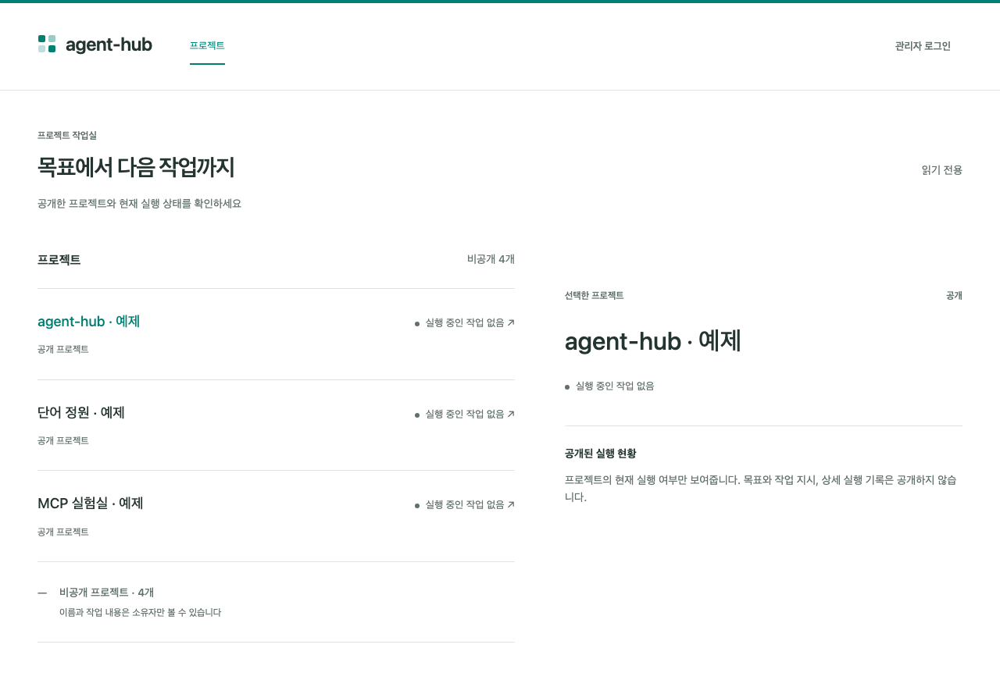
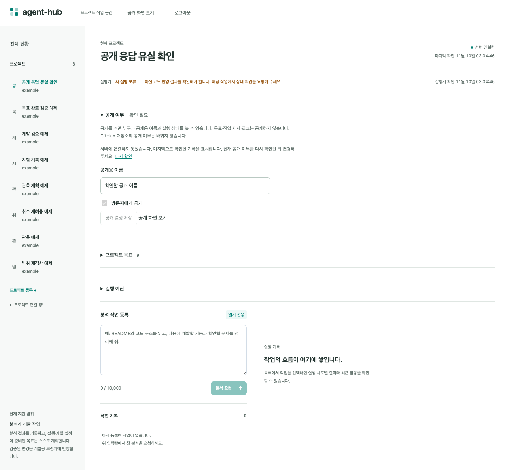

# 사용 흐름과 공개 경계 검증

2026-11-10 · 공개 화면 PR #3을 기준으로 [안정화 계획](../plans/usability-stabilization.md)을 검증했습니다. 코드 수정은 `4cd7187`에 있습니다. 아래 결과는 임시 DB·가짜 AI·합성 인증값을 사용한 검사입니다.

## 고친 문제

공개 설정을 저장한 직후 응답이 끊기면, 서버는 공개 상태인데 화면은 이전의 **비공개** 표시를 유지했습니다.

이제 결과를 확인하지 못하면 **확인 필요**로 표시합니다. **다시 확인**으로 서버 상태를 읽은 뒤에만 편집·저장할 수 있습니다. 저장 중이나 재조회 중의 겹치는 요청도 막습니다. DB 구조와 서버 권한 정책은 바꾸지 않았습니다.

실제 저장 후 브라우저 응답만 끊는 테스트가 수정 전에는 실패하고 수정 후에는 통과했습니다. 재조회를 지연시킨 동안 저장이 막히는지, 확인 후 비공개로 바꿀 수 있는지도 검사했습니다.

## 계획별로 확인한 것

| 계획 | 확인한 동작 | 근거 |
| --- | --- | --- |
| 첫 사용 흐름 | 로그인, 프로젝트 등록·연결 화면, 목표 등록·수정, 실행·대기·결과 표시 | [관리 화면 브라우저 검사](../../apps/web/e2e/workspace.spec.ts) |
| 연결 끊김·응답 유실 | 마지막 확인 기록과 오류 표시, 세션 만료 후 로그인, 목표·작업의 같은 요청 재사용 | 같은 브라우저 검사와 [인증 검사](../../apps/server/tests/authentication.test.ts) |
| 재시작·실행 제한 | 세션·목표 이력·기간 예산 보존, 강제 종료 후 복구, 취소와 중복 실행 방지 | [실행 컨테이너 검사](../../apps/server/tests/execution/execution-process.test.ts), [예산 검사](../../apps/server/tests/period-budget.test.ts), [Linux 운영 검사](../../apps/server/tests/operations.test.ts) |
| 공개 경계 | 기본 비공개, 공개용 이름만 반환, 익명 조회·변경 제한, 공개 철회, 오류 응답의 내부 정보 차단 | [공개 API 검사](../../apps/server/tests/project-publication.test.ts), [공개 화면 검사](../../apps/web/e2e/public-workspace.spec.ts) |

GitHub 화면의 외부 응답은 대역으로 검증했습니다. 서버의 가져오기 검사는 임시 소스·Git 저장소를 사용합니다. 이 결과로 실제 개인 GitHub 계정 연결까지 확인했다고 판단하지 않습니다.

## 실행한 검사

| 명령·검사 | 결과 |
| --- | --- |
| `pnpm --filter @agent-hub/server test` | 1,026개 통과, 컨테이너 검사 68개 제외 |
| `RUN_CONTAINER_TESTS=1`로 실행 컨테이너 파일 검사 | 35개 통과 |
| 같은 설정으로 아래 나머지 컨테이너 관련 파일 검사 | 83개 통과. 일부 일반 검사가 중복되므로 위 숫자와 합산하지 않음 |
| gstack `verify` | 타입·린트·빌드·관련 검사 통과. 화면 API 5개, 관리 화면 22개 포함 |
| 공개 화면 Playwright 검사 | 1개 통과. 관리 화면과 합쳐 서로 다른 브라우저 시나리오 23개 |
| `pnpm check`, `git diff --check` | 통과 |
| gstack 코드 검토 | 부모 체크리스트와 별도 Codex 검토에서 수정 후 미해결 결함 없음. 외부 Claude 검토는 비활성 |

컨테이너 검사는 실제 모델을 호출하지 않습니다. 다음 명령으로 같은 파일들을 활성화해 검사할 수 있습니다.

```sh
RUN_CONTAINER_TESTS=1 pnpm --filter @agent-hub/server exec vitest run \
  tests/execution/execution-process.test.ts \
  tests/execution/codex-sandbox.test.ts \
  tests/execution/verification-process.test.ts \
  tests/legacy-runner.test.ts tests/operations.test.ts \
  tests/execution/development-executor.test.ts \
  tests/goals/development-journal.test.ts --maxWorkers=1
```

컨테이너 안의 HTTPS·앱 재시작 검증과 실제 Linux 호스트의 systemd 검증은 구분합니다. Ubuntu 22.04·24.04의 전체 검사는 [GitHub CI 실행 기록](https://github.com/lmj00/agent-hub/actions/workflows/ci.yml)에서 해당 브랜치·커밋을 확인합니다.

## 화면 확인

모두 가상 프로젝트입니다. 공개 화면은 390px 모바일 폭에서 가로 넘침 없이 선택이 반영됐고, 확인한 공개 화면의 콘솔 오류는 없었습니다. 전체 접근성·성능 평가를 대신하는 결과는 아닙니다.

<details>
<summary>공개 화면: 데스크톱·모바일</summary>




</details>

<details>
<summary>저장 응답이 끊긴 뒤의 관리 화면</summary>



</details>

## 소유자가 직접 확인할 것

1. 실제 GitHub App에서 선택한 저장소만 보이는지, 비공개 저장소 가져오기와 접근 철회가 동작하는지 확인합니다.
2. 실제 Codex 인증과 사용 한도를 연결한 예제 목표에서 실행·대기·완료를 확인합니다.
3. 배포 전 접속 범위·HTTPS·백업·알림 수신처를 확인하고 장기 운영 기록을 남깁니다. 이번 작업에서는 운영 서버와 트레이딩 서비스를 변경하지 않았습니다.

확인한 것은 위 시나리오의 동작입니다. 임의 프로젝트에서의 AI 개선 품질과 실제 서버의 24시간 무인 운영은 별도 운영 검증으로 남습니다.
