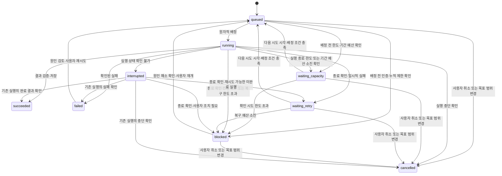

# 작업 상태와 실행 복구의 상세 규칙

API·상태·취소·복구·관측·인증의 상세 기준입니다. 문서의 단계 번호는 도입 순서를 뜻하며, 최신 구현 상태는 [진행 상태](../02-implementation-plan.md)를 따릅니다.

[문서 길잡이](../README.md)

- [작업과 실행 시도 구분](#작업과-실행-시도-구분)
- [작업 상태](#작업-상태)
- [진행 상황과 서비스 상태 관측](#진행-상황과-서비스-상태-관측)
- [배정과 복구](#배정과-복구)
- [취소와 제한 시간](#취소와-제한-시간)
- [관리 API 로그인과 세션 보호](#관리-api-로그인과-세션-보호)

## 작업과 실행 시도 구분

프로젝트의 장기 목표는 `Goal`, 사용자 또는 총괄이 만든 개별 작업은 `Task`, 그 작업을 실행한 각 시도는 `Run`으로 구분합니다. 재시도할 때 이전 실행 기록을 덮어쓰지 않습니다. 목표 판단을 위한 AI 호출도 계획용 Task·Run·Step으로 기록해 제한·복구 대상에 포함합니다.

하나의 Run은 여러 순차적 AI 호출 단계(`Step`)로 구성할 수 있습니다. 정상적인 단계 전환이나 effort 변경은 재시도가 아니므로 새 Run을 만들지 않습니다. Step별 세션과 결과를 기록하고 다음 호출에 필요한 맥락을 전달합니다.

아래는 기록의 목적을 정리한 설계 개요이며, 실제 테이블·필드 목록과 일대일로 대응하지 않습니다. 현재 저장 형식은 [DB 스키마](../../apps/server/src/db/schema.ts)와 마이그레이션을 기준으로 확인합니다. 괄호 안은 코드에서 사용할 이름이며, 각 기록마다 별도 서버를 만드는 뜻은 아닙니다. ID·식별자는 기록을 구별하는 값이고, 체크섬은 파일 내용이 같은지 확인하는 데 쓰는 계산값입니다.

| 저장할 기록(코드 이름) | 주요 항목 |
| --- | --- |
| 프로젝트 (`Project`) | ID, 표시 이름, 작업 공간 식별자, 허용 정책, 생성 시각 |
| 프로젝트 목표 (`Goal`) | ID, 프로젝트 ID, 목표·완료 기준, 목표 버전, 유한/지속 관리 구분, 우선순위, 상태, 허용 범위, 다음 점검 시각, 기간 예산·사용 기록, 정책 버전 |
| 다음 작업을 선택한 판단 (`PlanningDecision`) | ID, 목표 ID·버전, 계획 실행 ID, 판단 근거·코드 버전, 생성 키, 선택·보류 이유, 다음 점검 시각 |
| 개별 작업 (`Task`) | ID, 프로젝트 ID, 지시, 상태, 등록 요청 키, 제한 시간, 취소 요청 시각·주체·사유, 재시도 정책, 재시도 횟수, 다음 시도 시각, 누적 실행 시간, 보류 사유 |
| 실행 시도 (`Run`) | ID, 작업 ID, 앱 실행 인스턴스 ID, SDK 세션 ID, 시작·종료 시각, 현재 단계, 최근 이벤트·진척 시각, 대기 사유, 다음 행동, 종료 사유 |
| 실행별 컨테이너 (`RunExecution`) | Run ID, 순번, 컨테이너 전체 ID·소유 토큰·엔진 ID, 생성 기록 시각, 종료 확인 시각. 내부 식별자는 공개 응답에 포함하지 않음 |
| AI 호출 단계 (`Step`) | ID, 실행 ID, 순번, 단계 목적, 상태, 모델·SDK 세션 ID, 제안·적용 effort, 선택 근거·정책 버전, 시작·종료 시각, 제공된 사용량, 결과·근거 참조 |
| 실행 중 발생한 일 (`Event`) | 실행 ID, 순번, 종류, 비밀 정보 제거 후 메시지, 시각 |
| 결과 파일 정보 (`Artifact`) | 실행 ID, 저장 위치 식별자, 종류, 크기, 체크섬 |
| 변경 반영 기록 (`ChangeApplication`) | 반영 작업 ID, 작업·실행 ID, 기준 커밋, 검증한 내용 식별값, 결과 커밋, 대상 브랜치, 반영 상태 |
| 계정별 실행 제한 기록 (`ProviderGate`) | 제공자·계정의 비공개 식별자, 차단 범위·사유, 다음 시도 시각, 확인 시도 횟수, 확인 실행 ID |
| 상태를 확인할 서비스 (`ServiceTarget`) | ID, 프로젝트 ID, 표시 이름, 비공개 연결 설정 식별자, 관측 주기, 정상 동작 기준 |
| 서비스 상태 확인 결과 (`ServiceObservation`) | 대상 ID, 관측·수신 시각, 수집 성공 여부, 프로세스·업무 상태, 최근 업무 처리 시각, 근거와 오류 요약 |

자율 실행의 Task에는 종류(`planning`·`work`), 목표 연결과 생성 근거, 완료 기준, 개발 기준 등을 기록합니다. 세부 기록은 Task와 연결된 계획·개발 테이블에 나누어 보관합니다. Step에는 총괄·개발·검증 역할과 검토 결과를 기록합니다. 계획 결과 저장과 후속 Task 생성은 한 트랜잭션으로 처리하고 같은 생성 키로 기록을 두 번 저장할 수 없도록 DB에 중복 방지 조건(유일성 제약)을 둡니다. 재시작·중복 이벤트로 같은 후속 작업이 두 번 생기지 않아야 합니다. 변경 반영 기록(`ChangeApplication`)으로 반영 여부를 확인하고 중단 후 복구합니다.

프로젝트 작업 공간 식별자는 비공개 설정에서 실제 경로로 변환합니다. 사용자 입력을 실행 명령 문자열에 그대로 끼워 넣지 않고, 실행할 프로그램과 전달할 값 목록(인자 배열)을 분리합니다. worker 분리 단계에서 실행 프로그램 ID, 실행 권한 토큰과 만료 시각을 추가합니다.

이전 작업을 참고할 때는 관련 Task·Run·검증 결과와 당시 코드 버전을 조회해 필요한 내용만 에이전트에게 전달합니다. 기록 저장만으로 모델이 자동으로 기억하는 것은 아니며, 이전 결과가 현재 코드에도 유효한지 다시 확인합니다.

### 1단계 프로젝트 API

프로젝트 API는 기본 정보의 등록·조회를 담당합니다. 실제 폴더·허용 정책 확인과 AI 연결은 실행 모듈이 담당하며, 프로젝트 등록 요청 자체가 AI를 실행하지는 않습니다.

| 요청 | 응답 |
| --- | --- |
| `POST /projects` | JSON으로 `name`, `workspaceKey`를 받고 UUID·생성 시각을 서버에서 부여. `201`과 프로젝트 정보, 상세 조회 주소를 담은 `Location` 헤더 반환 |
| `GET /projects` | `{ "projects": [...] }`. 생성 시각 내림차순, 같은 시각이면 ID 오름차순. 현재 개인용 초기 버전은 전체 목록 반환 |
| `GET /projects/:id` | 프로젝트 정보 반환. UUID 형식 오류는 `400`, 해당 ID가 없으면 `404` |

프로젝트 응답에는 `id`, `name`, `workspaceKey`, UTC ISO 8601 문자열인 `createdAt`만 포함합니다. 조회 결과가 오래 남지 않도록 프로젝트 API 응답에 `Cache-Control: no-store`를 지정합니다.

- 이름은 입력 기준 1~100자이고 공백만으로 작성할 수 없습니다. 앞뒤 공백을 제거해 저장합니다.
- 작업 공간 식별자는 1~100자이며 영문·숫자로 시작하고 영문·숫자·점·밑줄·하이픈만 허용합니다. 대소문자를 보존하며 실제 경로로 해석하거나 파일을 열지 않습니다.
- 등록은 `application/json`으로 받습니다. 누락·잘못된 타입·정의하지 않은 필드는 자동 보정하지 않고 `400`으로 거부합니다. JSON 이외의 요청은 `415`로 거부합니다.
- 프로젝트 ID만 고유합니다. 같은 이름·작업 공간 식별자로 다시 POST하면 새 ID를 가진 프로젝트를 등록합니다. 작업(Task)의 등록 요청 키에 의한 중복 방지와 구분합니다.
- 오류 응답은 `{ "error": "오류 코드", "message": "설명" }`입니다. 입력 오류는 `INVALID_REQUEST`, 없는 프로젝트는 `PROJECT_NOT_FOUND`, DB 등 내부 오류는 `500`과 `INTERNAL_ERROR`입니다. 내부 오류의 SQL·경로는 응답에 넣지 않고 서버 로그에 기록합니다.

### 1단계 작업 API

작업은 프로젝트에 속하며 Goal 없이 `queued` 상태로 등록합니다. 등록 API 자체는 AI를 실행하지 않습니다. 2단계의 실행 모듈이 작업 상태를 변경하며, 조회·동일 요청 재전송 응답에는 그 시점의 상태를 반환합니다.

| 요청 | 응답 |
| --- | --- |
| `POST /projects/:projectId/tasks` | JSON으로 `instruction`, `requestKey`를 받음. 새 작업은 `201`, 동일 등록 요청의 재전송은 `200`. 두 경우 모두 작업 정보와 `/tasks/{id}`를 담은 `Location` 헤더 반환 |
| `GET /projects/:projectId/tasks` | `{ "tasks": [...] }`. 해당 프로젝트만 생성 시각 내림차순, 같은 시각이면 ID 오름차순으로 조회. 현재 전체 목록 반환 |
| `GET /tasks/:id` | 작업 한 건의 정보 반환 |

응답 필드는 `id`, `projectId`, `instruction`, `requestKey`, `status`, UTC ISO 8601 문자열인 `createdAt`입니다. 프로젝트·작업 ID는 UUID이며 서버가 생성합니다. 등록 요청 키는 클라이언트가 생성하고 대소문자를 구분합니다. 응답은 `Cache-Control: no-store`를 사용합니다.

- 지시는 입력 기준 1~10,000자이고 공백만으로 작성할 수 없습니다. 앞뒤 공백을 제거해 저장·비교하며 내부 공백·줄바꿈은 보존합니다.
- 요청 키는 1~100자이며 영문·숫자로 시작하고 영문·숫자·점·밑줄·하이픈만 허용합니다. UUID 문자열도 사용할 수 있습니다.
- 같은 프로젝트·같은 키·같은 지시는 기존 작업 정보를 반환합니다. 같은 키에 다른 지시는 `409 / REQUEST_KEY_CONFLICT`이며 기존 내용을 바꾸지 않습니다. 같은 지시라도 키가 다르면 별개 작업을 생성합니다.
- 키의 범위는 프로젝트별입니다. 키를 DB에 저장하므로 재시작 후에도 중복을 방지하며, 현재 만료·삭제 기능은 없습니다. 요청 형식에 새로운 실행 옵션이 추가되면 같은 요청인지 비교하는 기준에도 포함합니다.
- 없는 프로젝트는 등록·목록 모두 `404 / PROJECT_NOT_FOUND`, 없는 작업은 `404 / TASK_NOT_FOUND`입니다. 잘못된 ID·본문은 `400 / INVALID_REQUEST`, JSON 이외의 등록 요청은 `415 / INVALID_REQUEST`입니다.
- 내부 오류는 상세 SQL·경로를 로그에 남기고 `500 / INTERNAL_ERROR`로 응답합니다. DB 준비 상태는 프로젝트·작업 테이블을 모두 조회해 확인합니다.

DB의 `(project_id, request_key)` 유일성 제약과 짧은 트랜잭션으로 등록 또는 기존 기록 반환을 처리합니다. 다른 프로젝트 기능의 내부 DB 코드에는 접근하지 않고 `app.ts`에서 전달한 프로젝트 존재 확인 함수를 사용합니다. DB 외래 키로도 없는 프로젝트에 작업이 저장되지 않게 하며 작업이 연결된 프로젝트 삭제를 막습니다.

### 2단계 첫 분석 실행의 현재 범위

현재 실행 경로는 `run-task-cli.ts → runTask → AnalysisExecutor → Codex SDK`입니다. `containerImage`를 설정하면 SDK가 Run 전용 로컬 컨테이너에서 실행됩니다. `runTask`는 실행 순서·시간 제한·상태 판단을 담당하고, DB 저장은 `RunStore`, 실제 AI 호출은 `AnalysisExecutor`를 통해 요청합니다. HTTP 조회는 저장된 기록만 읽습니다. 실행 명령과 인증 설정은 [README](../guides/agents.md#codex로-작업-한-건-분석하기)에 있습니다.

1. CLI가 프로젝트의 작업 공간 식별자를 비공개 설정의 준비된 폴더로 변환합니다. 인증·설정을 먼저 확인하며 이 단계에서 실패하면 작업은 대기 상태로 남습니다.
2. 짧은 DB 트랜잭션에서 다른 실행·보류 기록을 확인하고, Task를 `running`으로 바꾸면서 Run·Step·시작 이벤트를 함께 만듭니다. DB에도 활성 Run 하나만 허용하는 조건을 둡니다.
3. 트랜잭션 밖에서 Codex를 호출합니다. 기본은 한 번이며 `analysisWorkflow`를 켜면 정해진 상한 안에서 순차 호출합니다. 모델은 설정에서 명시하고 effort는 기본 medium 또는 설정한 초기 선택 정책으로 정합니다. SDK 세션 ID와 제공된 사용량은 Step에 저장합니다. Step별 모델·effort·선택 근거·결과·사용량을 조회하며 Run의 effort는 최근 Step의 적용 값입니다.
4. 성공은 정상 종료된 호출이 비어 있지 않은 64 KiB 이하의 분석문을 반환하고 DB에 저장된 상태입니다. 분석 내용의 정확성이나 후속 구현·테스트까지 검증됐다는 뜻은 아닙니다. Task·Run·Step의 최종 상태와 종료 이벤트는 함께 저장합니다.

| 조회 API | 응답 |
| --- | --- |
| `GET /tasks/:id/runs` | `{ "runs": [...] }`. 해당 작업의 실행 이력, 시도 번호(`attempt`) 내림차순 |
| `GET /runs/:id` | 실행 상태·모델·effort·시각·결과·오류 분류, 호출 단계와 순서대로 정렬한 이벤트 |

잘못된 UUID는 `400`, 없는 대상은 `404`입니다. 실행 인스턴스 내부 식별자·작업 폴더·인증 경로는 응답에 넣지 않으며 `Cache-Control: no-store`를 사용합니다. 현재 서버는 로컬 주소에서 실행하며, 기본 접근 모드는 단일 사용자 인증입니다. 인증 없는 API 개발은 `LOCAL_API_ONLY=1`을 명시해야 합니다. 원격 운영용 HTTPS·배포 검증은 6단계에서 진행합니다.

이벤트에는 종류·시각·순번을 저장하고 명령 원문·도구 인자·추론 텍스트는 저장하지 않습니다. 최초 이벤트를 포함해 최대 1,000개를 남기고 최종 상태 이벤트 하나를 추가할 수 있습니다. `lastActivityAt`은 이후 이벤트에도 갱신되며 활동 기록이지 진행률·프로세스 생존 확인이 아닙니다. 분석 결과에서 흔한 인증 문자열을 제거하지만 모든 비밀 정보를 식별한다고 보장하지 않습니다. 따라서 입력 폴더부터 비밀 정보 없는 사본을 사용하고 결과·DB는 비공개로 관리합니다.

확인된 인증·지원 설정 오류는 `blocked`, 한도 오류는 `waiting_capacity`, 그 밖의 종료가 확인된 오류는 `failed`입니다. 오류 분류는 SDK 오류 메시지에 근거하며 재시도 시각이나 남은 구독 한도를 추정하지 않습니다.

중단의 실제 종료가 불확실하면 `interrupted`로 두고 종료 시각은 비워둡니다. 종료가 확인된 사용자 취소·범위 축소는 각 사유를 가진 `cancelled`, 시간 초과는 `failed`, 서버 종료는 `waiting_retry`입니다.

자동 복구를 켜면 `transient` 실패·서버 종료·소유자 상실에 제한된 재배정을 적용합니다. 과거 Run의 실패와 Task의 다음 시도 대기는 구분합니다.

강제 종료 후 남은 `running`도 종료 대조 전까지 새 실행을 막습니다.

중단 신호와 분석 응답을 따로 기다려, SDK가 중단 신호에 응답하지 않아도 상태 저장으로 넘어갑니다. 중단 순간부터 추가 이벤트 저장을 차단하고 뒤늦은 성공·실패는 기존 상태를 변경하지 않습니다. DB 연결을 닫은 뒤 도착한 이벤트도 무시합니다. 이 대기 중단 자체는 실제 자식 명령 종료의 근거가 아닙니다. 별도 관측으로 종료가 확인되지 않은 `interrupted`는 계속 신규 실행을 막습니다.

중단 원인과 요청 시각은 실행에 중단 신호를 보내기 전에 저장합니다. 수동 CLI의 `SIGINT`는 사용자 취소, `SIGTERM`과 서버 루프 종료는 서버 종료, Run 제한 시간은 시간 초과로 구분합니다. 처음 저장한 중단 사유를 뒤늦은 신호로 덮어쓰지 않습니다. 사용자 취소는 Task에도 요청 시각을 남깁니다. 저장 실패 시에도 신호는 보내지만 실패를 보고하고 기존 활성 Run을 유지합니다.

범위 축소는 Goal 변경·버전 이력·Run 중단 의도를 한 트랜잭션으로 저장합니다. 현재 파일 목록만 비교하지 않고 허용/제외 경로가 가리키는 하위 영역까지 비교해 아직 없는 경로의 권한 축소도 감지합니다. 이미 저장된 다른 중단 사유는 유지합니다. 사용자 취소 시각은 새로 만들지 않으며 계획 Task라는 이유만으로 Goal을 일시정지하지 않습니다.

서버와 CLI의 공통 실행 경로는 호출 전·이벤트 수신 때와 무출력 중 500ms 간격으로 저장된 중단 요청을 확인합니다. 소유권이나 요청을 읽지 못하면 기존 권한이 계속 유효하다고 가정하지 않고 미확인 사유로 중단합니다. 범위 변경 중단도 전체 종료를 확인해야 `cancelled`로 확정하며 그 전에는 `interrupted`로 보존합니다. 완료 직전이나 종료 대조 중 범위가 줄어도 늦은 성공 결과를 적용하지 않습니다. 실행 전 계획 작업은 별도의 범위 재검사로 새 버전에 연결합니다.

작업별 `Run.attempt`는 배정 트랜잭션에서 증가시키며 DB의 `(task_id, attempt)` 유일성 제약으로 중복을 막습니다. 실행 목록·최근 실행 판단에는 이 번호를 사용합니다. 취소 의도가 남아 있는 Task는 `queued`라는 상태만으로 배정하지 않습니다. 상태 확정 시에도 Task의 취소 의도를 다시 확인하고 Task·Run·Step에 같은 결과를 저장합니다.

Run 조회의 `stopReason`·`stopRequestedAt`은 요청 근거, `terminationConfirmedAt`은 실제 종료 확인 근거입니다. 컨테이너 모드는 전체 ID·임의 토큰·Docker 엔진을 대조하고 전용 PID 공간의 종료를 확인한 뒤 이 시각을 저장합니다. 직접 SDK 실행과 구버전 기록은 `null`이며 응답이나 부모 종료만으로 채우지 않습니다. 이전 버전의 `cancel_requested`는 `unknown`으로 보존하고 요청 시각도 추측하지 않습니다.

한 Run 안에서 컨테이너를 순차적으로 사용할 수 있도록 `run_executions`에 각각의 식별자·순서·종료 근거를 보존합니다. 저장 확인 전에는 컨테이너를 시작하지 않고, 이전 컨테이너의 종료 근거를 저장하기 전에는 다음 것을 배정하지 않습니다. Run당 최대 12개이며 동시에 미확인 실행 하나만 허용합니다. 이 자원 상한은 기존 AI 호출·재작업·시간 예산을 늘리지 않습니다. 전체 종료 확인을 시작한 Run에는 뒤늦게 새 컨테이너를 붙이지 못합니다.

복구는 이미 저장한 종료 근거를 유지하고 아직 확인하지 못한 컨테이너만 관측합니다. 관측한 목록과 DB의 현재 목록이 다르면 전체 종료를 확정하지 않습니다. 최종 종료 근거와 Run 완료는 같은 트랜잭션에서 저장한 뒤 컨테이너를 정리합니다. 이 기록을 개발·테스트·독립 검토의 순차 실행과 복구에 사용합니다. 실제 연결 검증은 [진행 상태](../02-implementation-plan.md)에서 확인합니다.

종료 관측은 DB 트랜잭션 밖에서 최대 8초 기다립니다. 확인하지 못하면 분석문이 있어도 `interrupted`로 저장합니다. 아직 시작하지 않은 컨테이너는 조회 직후 늦은 시작 요청이 도착할 수 있으므로 `created`만으로 종료를 확정하지 않습니다. 강제 삭제 없이 전체 ID 제거가 성공한 경우에만 시작 불가능의 근거로 삼습니다. 실행을 시작한 컨테이너는 종료 근거를 DB에 저장한 다음 정리합니다. 먼저 제거된 컨테이너의 저장이 실패하거나 Docker 관측이 불가능하면 보류를 유지합니다.

컨테이너는 일반 사용자·관리 권한 없음·호스트 PID 공간과 Docker 소켓 미연결로 실행합니다. 작업 폴더는 읽기 전용이며 다른 프로젝트·DB는 마운트하지 않습니다. SDK의 읽기 전용·인증 폴더 차단·모델 명령의 네트워크 금지 설정도 유지합니다. Docker는 모델의 통신을 위한 네트워크와 실행 전체의 수명을 제공하며, SDK가 명령별 파일·네트워크 접근을 제한합니다. 컨테이너가 사라졌다는 조회 실패나 엔진 변경은 종료 증명이 아닙니다.

Codex 내장 웹 검색은 공개 문서를 조회하기 위해 `live`로 허용합니다. 이는 모델 명령의 네트워크 권한을 열지 않습니다. 역할 지침의 외부 서비스 제한 중 내장 웹 검색에만 실행기 공통 정책으로 예외를 두며, 검색 결과도 신뢰할 수 없는 입력으로 취급합니다. 검색 근거와 한계는 보고서에 남깁니다. 검색어의 민감정보 제외는 모델 지침이며 강제 요청 필터는 아니라는 한계는 [공개 문서 검색](../guides/agents.md#공개-문서-검색)에 설명합니다.

현재 실행 자리와 제공자 차단을 분리했습니다. 실행 중인 Run과 종료 미확인 보류는 실행 자리를 점유하며, 종료가 확인된 과거 보류 Run은 이력을 유지하면서 자리를 해제합니다. `ProviderGate`는 같은 DB의 인증·한도·공통 실행 설정 문제로 새 배정을 막습니다. 단일 계정 단계이므로 Codex 로그인 전체를 같은 범위로 묶습니다. 실제 계정 ID를 확인했다는 가정을 하지 않고, 인증 경로·모델·프로젝트 변경으로 우회되지 않게 합니다.

차단 기록에는 사유·버전·원인 Run·제공된 재시도 시각·확인 작업 및 실행 ID를 둡니다. `GET /execution/provider-gate`로 공개 가능한 상태만 조회합니다. 시각은 SDK 오류에서 시간대가 포함된 절대 시각을 확인했을 때만 저장합니다. SDK가 별도 구조화된 시각을 제공하는 것으로 가정하지 않습니다. 시각 경과·인증 파일 존재·서버 재시작으로 차단을 풀지 않습니다.

확인 작업의 목표가 일시정지되거나 버전이 바뀌면 아직 시작하지 않은 예약만 교체할 수 있습니다. 원인 실행의 종료와 전체 미확인 실행 유무를 먼저 확인하고, 현재 목표·등록된 작업 공간·취소·복구 요청·Task 재시도/시간 상한·기간 예산을 통과한 대기 작업을 선택합니다. 개발 실행 연결을 기다리는 작업은 후보에서 제외합니다. 적격 작업이 없으면 보류하고 다음 조회에서 다시 확인합니다.

교체 시 원인 Run·계정 확인 횟수·제공자 시각·내부 다음 확인 시각을 보존합니다. 예약 대상 변경은 계정 차단 버전을 올리고 한 트랜잭션으로 처리하며, 실제 호출을 시작할 때만 확인 횟수를 소비합니다. 이미 시작한 확인 실행이나 종료 미확인 실행은 교체하지 않습니다. 인증·설정 차단, 계정 확인 상한도 그대로 적용합니다.

확인 실행은 차단 버전·재시도 시각·종료 근거를 검사해 하나만 예약하고, 해당 작업만 배정합니다. 성공 결과와 실제 종료 근거를 같은 트랜잭션으로 저장했을 때 해당 버전의 차단을 해제합니다. 종료가 확인된 실패·중단은 예약을 정리하되 차단을 유지합니다. 확인 응답이 성공해도 종료 미확인이면 `interrupted`로 두고 예약·버전을 보존하여 다른 확인 실행을 막습니다. 이후 같은 실행의 종료가 확인되면 기존 결과를 확정합니다. 해제 후에도 버전을 유지해 과거 요청이 새 차단에 적용되지 않게 합니다.

확인 실행 예약·배정·완료와 아래 수동 복구 API를 구현했습니다. 일시 오류·서버 중단의 자동 재시도와 한도 자동 확인을 추가했고, 최초 effort 선택과 호출 사이의 제한된 단계 전환도 구현했습니다.

### 2단계 자동 대기열의 현재 범위

서버 시작 시 `EXECUTION_CONFIG`를 지정하면 HTTP 요청을 받기 시작한 뒤 실행 루프를 시작합니다. 설정을 지정하지 않으면 등록·조회만 수행합니다. HTTP 포트 열기에 실패하거나 설정 검사를 통과하지 못한 서버는 AI를 실행하지 않습니다.

대기 작업 선택과 Run 생성은 같은 트랜잭션입니다. 설정에 연결된 프로젝트의 `queued` 작업을 등록 시각·ID 오름차순으로 하나 선택하고, 한 분석이 끝난 뒤 다음 작업을 선택합니다. 연결되지 않은 작업 공간의 Task는 대기로 남깁니다. 처리할 작업이 없거나 기존 Run 때문에 보류 중이면 1초마다 확인하며 AI를 호출하지 않습니다. 자동 복구가 꺼져 있으면 확인된 실패는 재배정하지 않습니다. 켜져 있으면 저장된 재시도 정책과 시각을 적용하며, 재시도 대기 중에도 계정 차단·종료 미확인이 없다면 다른 Task는 실행할 수 있습니다.

실행 소유권(`execution_owner`)은 같은 로컬 DB를 사용하는 자동 실행 서버와 수동 CLI 중 하나만 실행 모듈을 맡도록 하는 기록입니다. 시작 시 무작위 토큰·호스트 이름·부모 PID를 함께 저장하고 정상 종료 시 자신이 가진 기록만 해제합니다. 새 Run을 만들거나 기존 기록을 갱신할 때도 소유권을 확인합니다. 조회 전용 서버는 이 소유권을 요구하지 않습니다.

잠금은 시간 경과만으로 만료하지 않습니다. 같은 호스트에서 기존 부모 PID가 존재하지 않는다고 확인된 경우에만 새 부모가 소유권을 맡을 수 있습니다. PID가 재사용됐거나 확인 권한이 없거나 호스트가 다르면 보류합니다. 이 확인은 부모에 한정되며 자식 명령 종료의 증거로 사용하지 않습니다. 기존 `running`·`interrupted` Run과 인증·한도 보류는 소유권 교체 뒤에도 다음 AI 호출을 막습니다. 현재 소유권 확인은 같은 호스트·같은 PID 공간을 전제로 하며 여러 컨테이너나 원격 서버가 DB를 공유하는 방식은 지원하지 않습니다.

종료 요청 시 새 배정을 먼저 멈추고 현재 호출을 중단하도록 요청합니다. SDK의 응답을 무기한 기다리지 않고 실행 상태를 저장한 뒤 소유권·DB 연결을 닫습니다. HTTP·DB 종료 뒤에도 SDK 때문에 부모 서버가 남아 있으면 종료 요청 10초 뒤 부모를 종료합니다. 이 제한용 타이머 자체는 정상 종료를 지연시키지 않습니다. 재시작 시 미완료 Run을 임의로 성공·실패 처리하거나 다시 실행하지 않습니다. 컨테이너 실행은 아래 수동 복구 요청으로 종료·결과를 확인합니다. 자동 복구는 4단계입니다.

`GET /execution`은 현재 서버 루프의 상태, 관련 Run·Task ID, 대기·오류 분류, 마지막 대기열 확인 시각을 반환합니다. `running`은 이 서버가 호출을 처리하고 있다는 뜻이며 AI 프로세스의 생존 검증이나 진척률이 아닙니다. 실행 전 환경 검사 실패는 `error/configuration_invalid`, DB 처리 실패는 `error/storage_error`로 표시하고 새 호출 없이 재확인합니다. 조회 API의 `disabled`는 다른 CLI·서버가 실행 중인지 판단하는 값이 아닙니다.

대기열 오류는 `execution_queue.error` 서버 로그로 남깁니다. 단계(`recovery`·`validation`·`claim`·`execution`), 허용 목록의 오류 코드·고정 설명, 관련 Run·Task ID, 발생 횟수를 기록합니다. 감싸진 DB 오류는 제한된 깊이의 `cause`에서 코드를 확인하되 원문·스택·경로·SQL·임의 속성은 기록하지 않습니다. 설정 규칙 위반도 고정된 코드로 구분합니다. 알 수 없는 오류는 `UNKNOWN_ERROR`이며 상세 원인을 추측하지 않습니다.

같은 단계·실행·코드의 반복 오류는 최초 한 번과 이후 1분 간격으로 기록합니다. 다른 원인은 즉시 남기고, 실패했던 단계가 다시 정상 동작하면 `execution_queue.recovered`에 누적 횟수를 한 번 기록합니다. 실행 결과 저장이 실패한 뒤 단순한 대기열 조회가 성공했다고 저장 오류까지 복구됐다고 표시하지 않습니다. 이 진단 로그는 Run 보류 해제·실행 재개 기능과 별개입니다.

### 2단계 수동 복구 API

| API | 계약 |
| --- | --- |
| `POST /tasks/:id/recovery-requests` | `requestKey`, 최신 `runId`(이력 없으면 null), `action`을 받음. 선택 필드 `providerGateVersion`은 조회한 차단 버전. 새 접수 202, 동일 요청 재전송 200, 두 응답 모두 조회 주소를 Location에 반환 |
| `GET /recovery-requests/:id` | 접수 내용, 처리 상태(`pending/completed/rejected`), 처리 시 작업 상태(`resultStatus`), 거부 코드, 접수·종료 시각 조회 |

복구 요청 키는 작업별로 유일하며 형식은 작업 등록 키와 같습니다. 같은 키에 다른 action·Run·차단 버전을 보내면 409입니다. 최신 Run은 `attempt`로 판단하며 접수와 최종 저장 시 모두 대조합니다. 잘못된 입력 400, 없는 대상 404, JSON 외 본문 415, 실행 모듈이 없는 서버의 변경 요청 503, 상태 충돌 409를 반환합니다. 접수 후 확인 실패는 조회 응답의 `rejected/errorCode`로 전달합니다. 알 수 없는 필드와 클라이언트가 보낸 종료 근거는 받지 않습니다.

`resume`은 실제 종료 근거·취소 의도·차단 버전·재시도 시각을 확인하고 Task만 `queued`로 전환합니다. 새 Run은 정상 배정 처리에서 생성합니다. 이미 저장된 성공 결과가 있으면 이를 확정하고 다시 실행하지 않습니다. 현재 서버의 실행 중 작업, 취소한 작업, 종료 근거 없는 작업, 원인을 구별할 수 없는 옛 중단은 재개하지 않습니다. 재개를 수행할 실행기는 종료 관측 기능을 제공해야 합니다.

`reconcile`은 옛 실행을 종료·관측한 뒤 상태만 확정합니다. 사용자 취소·범위 축소는 해당 사유의 `cancelled`, 시간 초과는 `failed`, 서버 종료나 사라진 소유자의 미완료 실행은 `waiting_retry`, 모호한 중단은 `blocked`입니다. 종료만 미확인이었던 저장 결과는 `succeeded`로 수용합니다. 이 처리는 다음 실행을 자동 예약하지 않습니다.

`cancel`은 Task 취소 시각을 DB에 저장한 뒤 현재 Run에 신호를 전달합니다. 진행 중인 재개·상태 확인 요청이 있으면 이를 거부하고 취소가 우선합니다. 종료 근거가 없으면 `interrupted`를 유지합니다. 이미 저장한 성공은 바꾸지 않으며, 완료된 과거 Run의 이력을 취소 상태로 덮어쓰지 않습니다. 아직 시작하지 않은 확인 실행의 예약은 지우되 제공자 차단은 유지합니다.

대기열은 새 배정 전에 저장된 복구 요청을 처리하며 `/execution`에 `recovering`을 표시합니다. 외부 관측은 최대 8초이고 DB 트랜잭션 밖에서 수행합니다. 최종 저장에서 소유권·접수 상태·최신 Run·취소 의도·차단을 재확인합니다. DB 실패 시 요청은 pending으로 남고 컨테이너도 종료 근거 저장 전에는 제거하지 않습니다. 접수 후 서버가 재시작돼도 같은 요청을 이어 처리합니다.

한도·인증·설정 차단 중 재개는 차단을 지우지 않고 확인 실행 하나만 예약합니다. 차단 버전이나 재시도 시각이 바뀌었으면 새 조회·새 키로 요청해야 합니다. 중단된 확인 실행을 정리하면서 차단 버전이 증가한 경우도 마찬가지입니다. 실제 종료가 확인된 기존 이력은 보존하고, 종료 미확인 Run이 하나라도 있으면 새 확인 실행을 허용하지 않습니다.

## 작업 상태

작업이 `queued`(대기)에서 `running`(실행 중)으로 바뀌는 것처럼 상태가 바뀌는 것을 상태 전이라고 합니다. 상태 이름은 DB·API·화면에서 같은 의미로 사용합니다. `interrupted`는 실행 결과를 확인할 수 없다는 뜻이고, `blocked`는 사용자 조치가 필요하다는 뜻입니다. 둘을 단순한 실패로 합치지 않습니다.

| 상태 | 의미 |
| --- | --- |
| queued | 배정을 기다림 |
| running | 현재 실행 시도에서 작업 중 |
| waiting_capacity | 제공자 사용 한도 또는 Goal·프로젝트의 기간 예산으로 실행을 보류함. 사유와 적용 범위를 구분 |
| waiting_retry | 종료가 확인된 일시적 실패 이후 다음 시도 시각을 기다림 |
| blocked | 인증 복구나 재시도 한도 검토 등 사용자 조치가 필요함 |
| interrupted | 연결 단절·재시작 등으로 실제 종료 결과가 불명확함 |
| succeeded | 결과 검증과 저장이 완료됨 |
| failed | 실행 실패가 확인되고 종료 사유가 저장됨 |
| cancelled | 실행 전 취소됐거나 실행 중단이 확인됨 |

자동 복구는 첫 운영 버전의 필수 기능이며 현재 실행 서버에서 설정으로 켤 수 있습니다. 초기 수동 복구 단계를 거쳐 아래 자동 재개 정책을 연결했습니다. 재개는 배정 가능한 상태로 되돌리는 것이며, 이전 실행이 있다면 다음 배정에서 같은 Task에 새 Run을 만듭니다. 최초 배정 전에 보류했다면 첫 Run을 만듭니다. 이전 실행 기록을 덮어쓰거나 중간 지점부터의 실행을 보장하지 않습니다.

### 무인 운영의 자동 복구 정책

아래 표는 최종 목표 규칙입니다. 현재는 `automaticRecovery`를 지정한 서버에서 일시적 오류·서버 중단의 자동 복구를 구현했습니다. 계정 사용 한도 확인과 Goal·프로젝트의 기간 예산 집행도 연결했습니다. 코드 변경은 실제 Git과 DB 반영 이력을 대조해 복구합니다. 외부 알림은 O3의 다음 구현 범위입니다.

| 상황 | 처리 |
| --- | --- |
| 사용 한도 도달 | 실행 중이었다면 종료 확인 후 `waiting_capacity`로 보류하고 제공자가 알려준 재시도 가능 시각 이후 제한적으로 재시도 |
| Goal·프로젝트 기간 예산 소진 | `waiting_capacity`로 보류하고 다음 기간과 배정 조건을 확인해 자동 재개. 활성 Run이 있으면 다음 Step을 시작하지 않고 종료·작업 공간 상태를 확인 |
| 한도 회복 시각 미제공 | 회복 여부를 미확인으로 표시하고 간격을 늘려 제한적으로 재시도 |
| 일시적 네트워크·서비스 오류 | 실행 종료 확인 후 `waiting_retry`에서 대기하고 정책 범위 안에서 재시도 |
| 서버 재시작 | 기존 실행·결과를 대조하고 완료 결과를 복구하거나, 종료가 확인된 재시도 가능한 미완료 실행을 `waiting_retry`로 전환 |
| 실행 종료 여부 불명확 | `interrupted`를 유지하고 재확인·알림, 충돌 가능 실행은 배정하지 않음 |
| 인증 만료·복구 한도 초과 | 종료 확인 후 `blocked`로 보류하고 필요한 조치를 알림 |
| 재시도 불가능한 오류·실행 제한 시간 초과 | 종료 확인 후 `failed`로 기록하고 자동 재시도하지 않음 |
| 사용자 취소 | 중단 확인 후 `cancelled`, 자동 재시도하지 않음 |

### 재시도를 멈추거나 기다리는 기준

배정 전에 보류한 작업에는 Run을 만들지 않으며 재시도 횟수도 늘리지 않습니다. 기간 예산 때문에 기다리는 시간에는 한도 확인 호출을 보내지 않습니다. 실행 중 보류했다가 재개할 때는 기존 결과·변경을 확인하고 새 Run을 만듭니다. 기간 갱신만으로 인증 오류·반복 실패·Task 누적 예산 초과를 해제하지 않습니다. `ProviderGate`는 제공자·계정의 제한만 관리하며, Goal·프로젝트 기간 예산과 별도로 확인합니다.

- 최초·최대 대기 간격, 작은 무작위 지연, 최대 자동 재시도 횟수, Task 누적 실행 시간 상한을 설정합니다.
- 사용 한도 확인과 일시적 오류의 정책을 구분하고, 같은 오류가 연속으로 발생하는 횟수도 제한합니다. 일시 오류는 최초 10초·최대 5분, 한도 확인은 최초 15분·최대 6시간을 기본으로 사용합니다.
- 횟수, 다음 시도 시각, 누적 시간, 계정별 차단 상태를 DB에 저장합니다. 서버를 재시작해도 초기화하지 않습니다.
- 제공자가 알려준 재시도 가능 시각보다 먼저 호출하지 않습니다. 그 시각이 지났더라도 한도가 실제로 회복됐는지는 재확인이 필요합니다.

#### 현재 구현한 자동 복구

- `automaticRecovery`가 있으면 종료 관측 가능한 실행기만 허용합니다. 실행 루프는 수동 복구 접수 → 자동 복구 판단 → 일반 배정 순서로 처리합니다. 연결된 작업 공간의 Task만 대상으로 합니다.
- 정책·재시도 횟수·연속 오류·판단한 Run·다음 시각·보류 이유·누적 시간을 Task의 `retryState`에 저장합니다. 첫 배정 또는 기존 미완료 작업의 첫 검사에서 정책을 고정합니다. 기존 Run도 횟수·시간 계산에 포함합니다.
- 기본값은 최초 10초, 최대 5분, 0~20% 추가 지연, 새 실행 3회, 같은 오류 3회, 누적 실행 30분입니다. 횟수는 새 Run 배정 때 증가하고 예약·대기·재시작은 소비하지 않습니다. 수동 재개도 같은 상한과 다음 시각을 검사합니다.
- 완료 저장에서 연속 오류를 갱신합니다. 자동 루프가 판단하기 전에 들어온 수동 재개도 최신 횟수를 보게 합니다. Run별 이미 합산한 시간을 저장해 완료·복구를 반복해도 이중 계산하지 않습니다. 강제 종료 후에는 시작부터 종료 확인까지 보수적으로 합산합니다.
- `transient`·`server_shutdown`·`owner_lost`와 구체적인 후속 수정이 남은 `development_continue`를 자동 재배정합니다. 서버 재시작 때 이전 실행을 먼저 대조하고 종료 확인 뒤 예약합니다. 결과가 이미 있으면 기존 결과를 확정하며 새 실행을 만들지 않습니다. 개발 이어가기도 같은 Task의 재시도·누적 시간·기간 예산을 적용합니다.
- 종료 근거를 얻지 못하면 자동 대조 한 번 후 `termination_unconfirmed`로 보류합니다. 이후 수동 종료 확인이 성공하면 다시 정책을 판단합니다. 저장 실패는 트랜잭션을 되돌리므로 다음 검사에서 다시 처리할 수 있습니다.
- 시간 초과·사용자 취소·모호한 오류·인증·설정 오류는 자동 반복하지 않습니다. 한도 차단은 아래 계정 확인 정책을 사용합니다. 재시도 예약이 있어도 계정 차단과 다른 실행의 종료 미확인을 우회하지 않습니다.
- 유한한 누적 시간 상한이 소진되면 `blocked`로 두고 다음 호출을 하지 않습니다. 실행 중 남은 시간이 끝나면 기존 제한 시간 규칙에 따라 `failed`로 확정합니다. `maxRetries`, `maxConsecutiveErrors`, `maxTotalRunMs`의 명시적 `null`은 해당 상한을 해제합니다. 기존 작업도 다음 복구 검사·배정에서 해제하며, 횟수와 누적 시간은 보존하고 `recovery.limits_removed`를 기록합니다. 숫자로 바꾼 설정은 이미 저장된 정책을 덮어쓰지 않습니다. [설정과 적용 시점](../guides/agents.md#자동-복구-켜기)
- 상태 API·화면에 저장된 정책과 다음 시각을 표시하고, 현재 서버의 자동 복구 활성 여부를 별도로 제공합니다. 예약·보류 이벤트를 저장하지만 외부 채널 알림은 후속 단계입니다.

#### 계정 사용 한도 확인

`automaticRecovery.capacity`의 기본값은 최초 15분, 최대 6시간, 0~20% 추가 지연, 확인 최대 3회입니다. `false`는 새 자동 예약만 중지합니다. 실제 배정 전 Task 상한·사용자 취소·기존 실행 종료·계정 상태를 다시 검사합니다.

ProviderGate의 `capacityState`에 정책·실제 확인 횟수·내부 다음 시각·판단 버전·보류 이유를 저장합니다. 제공자가 알려준 `retryAt`은 별도 필드로 보존하고, 두 시각 중 더 늦은 때부터 확인 실행 하나만 예약합니다. 시각 미제공을 내부 예약으로 채우지 않습니다. 예약 자체는 횟수를 소비하지 않으며 실제 Run 배정에서 증가합니다.

확인 실패와 다음 대기 시각은 같은 완료 트랜잭션에서 저장합니다. 자동 루프보다 먼저 도착한 수동 요청도 대기 시각을 우회할 수 없습니다. 계정 정책은 첫 한도 오류 또는 구버전 차단의 첫 자동 검사에서 저장하고 회복이 확인될 때까지 유지합니다. Task·프로젝트·모델·서버 설정 변경으로 초기화하지 않습니다. Task의 더 엄격한 상한도 계속 적용합니다.

자동 확인 대상은 원인 Task입니다. 취소·미연결 작업 공간·Task 상한으로 사용할 수 없으면 이유를 남기며 다른 Task를 임의 선택하지 않습니다. 사용자가 다른 대기 작업으로 확인하더라도 계정 제한은 유지됩니다. 인증·설정 차단은 자동 확인 대상이 아닙니다. 외부 알림은 아직 연결하지 않았습니다.

### 같은 계정을 쓰는 다른 작업의 처리

계정별 실행 제한 기록(`ProviderGate`)은 AI 서비스 제공자·계정별로 새 실행을 막아야 하는지 관리하는 기록입니다. 같은 계정의 한도에 걸렸을 때 프로젝트를 바꿔 호출을 반복하지 않도록 합니다.

1. 한도에 걸린 계정으로는 다른 프로젝트도 새 실행을 시작하지 못하게 합니다. 한도 범위가 불명확하면 같은 계정 전체에 적용하고 근거를 남깁니다.
2. 재시도 시각에 확인 실행 하나만 허용합니다. 성공이 확인되면 차단을 해제하고, 다시 한도 오류가 나면 다음 시각을 갱신합니다.
3. 인증 만료도 해당 계정의 배정을 막습니다. 사용자가 재개를 요청해도 계정 차단과 기존 실행 종료 확인을 우회하지 않습니다.

배정할 때 보류 작업은 건너뛰고 실행 가능한 작업을 선택합니다. 단, 첫 버전의 동시 실행 수는 하나입니다. 이전 실행의 종료 여부가 불명확하면 새 AI 실행 전체를 보류하고 서비스 관측·상태 조회·복구 확인만 계속합니다. 알림 전송이 실패해도 이를 별도로 기록하고 다른 작업이나 복구 판단을 멈추지 않습니다.

## 진행 상황과 서비스 상태 관측

`running`이라는 저장 상태만으로 작업이 정상 진행 중이라고 판단하지 않습니다. 작업 상태와 별도로 관측 결과를 보여주고, 언제 확인한 정보인지 함께 표시합니다.

| 확인할 내용 | 근거 | 화면 표시 예시 |
| --- | --- | --- |
| agent-hub 응답 여부 | 상태 확인 요청 응답, 관측 시각 | 정상 응답 / 접속 불가 |
| 실행 프로세스 생존 | 자식 프로세스 상태와 종료 이벤트 | 실행 중 / 종료 확인 / 확인 불가 |
| 실행 활동 | SDK 이벤트, 도구 실행 시작·완료 시각 | 파일 읽는 중 / 테스트 명령 실행 중 |
| 실제 진척 | 완료 단계, 검증 결과, 저장된 산출물 | 구조 분석 완료 / 테스트 결과 수집 완료 |
| 대기 이유 | 사용량 제한, 외부 응답 대기, 입력 필요 등 확인된 사유 | 사용 한도 회복 대기 |
| 관측 신선도 | 마지막 수집 성공 시각과 설정한 유효 기간 | 최신 정보 / 오래된 정보 / 미확인 |

로그가 계속 출력되거나 프로세스가 살아 있다는 사실만으로 진척이 있다고 표시하지 않습니다. 반대로 출력이 없다는 이유만으로 프로세스가 죽었다고 표시하지 않습니다. `last_event_at`과 `last_progress_at`을 구분하고, 무진척 경고에는 판단 근거와 경과 시간을 함께 표시합니다. 모델의 사고 내용을 추정해 보여주거나 근거 없는 완료율을 만들지 않습니다.

실행 화면에는 최소한 목표, 현재 단계, 경과 시간, 최근 활동, 최근 진척, 대기 사유, 다음 행동을 보여줍니다. 다음 행동은 실행 정책과 확인된 결과에서 결정하며, 예를 들어 `분석 완료 후 결과 저장`, `사용 한도 확인 후 재개`, `기존 실행 종료 확인 필요`처럼 표시합니다. 알 수 없으면 미확인으로 표시합니다. 대기 작업 목록의 다음 작업과 보류 사유도 조회할 수 있게 합니다.

### 기존 장기 실행 서비스 관측

장기 실행 서비스는 끝나는 작업인 Task·Run과 별도로 ServiceTarget으로 등록합니다. 초기에는 명시적으로 설정한 읽기 전용 상태 API 또는 제한된 관측 인터페이스 하나를 연결합니다. 실행 프로세스 상태와 실제 업무 처리 신호를 함께 확인합니다. 예를 들어 주기 처리 서비스는 최근 처리 성공 시각, 오류 수, 다음 실행 예정 시각을 제공할 수 있습니다.

서비스별 정상 대기 조건과 예상 처리 간격을 설정합니다. 처리할 입력이 없는 정상 대기와 장애를 구분하고, 필요한 신호가 없는 서비스는 판단 한계를 표시합니다. 조회 실패는 우선 `관측 실패·상태 미확인`이며, 대상 서비스의 종료가 확인된 경우에만 종료로 표시합니다. 마지막 정상 기록은 과거 관측으로 남기고 현재 정상인 것처럼 표시하지 않습니다.

초기 관측 기능은 상태·오류·최근 처리 시각을 표시합니다. 대상 서비스의 중지·재시작·설정 변경이나 자동 복구는 수행하지 않습니다. 실제 접속 주소와 인증 정보는 비공개 설정에 둡니다.

**3단계 구현:** `SERVICE_CONFIG`에 연결할 대상·프로젝트·조회 주소·정상 대기 조건을 명시합니다. 서버는 GET 요청만 사용하며 리다이렉트·외부 HTTP·URL 내부 인증 정보·쿼리를 거부합니다. 요청 시간과 응답 크기를 제한하고 응답은 공통 스키마로 검사합니다. 서비스가 기록한 `observedAt`과 agent-hub의 `receivedAt`, 실제 업무 성공인 `lastSuccessAt`을 구분합니다. 응답에 나온 구성 토큰·흔한 인증 문자열은 저장 전에 제거하며 URL·토큰 설정은 DB·API로 내보내지 않습니다.

| 판단 순서 | 표시·근거 |
| --- | --- |
| 관측 꺼짐·기록 없음·결과 저장 오류 | 상태 미확인. 이전 성공으로 정상 표시하지 않음 |
| 요청 실패·잘못된 응답 | 관측 실패. 대상 프로세스의 사망을 추정하지 않음 |
| 미래 시각 | 상태 미확인. 시계 확인 필요 |
| 수집·보고 시각의 유효 기간 초과 | 오래된 정보. 최근 HTTP 수신만으로 오래된 원본을 최신으로 만들지 않음 |
| 명시적인 프로세스 종료 보고 | 종료 보고. 상태 API의 보고이며 OS 직접 검사는 아님 |
| 필수 상태 신호 부족 | 상태 미확인. 제공 신호 확인 필요 |
| 명시적인 업무 이상 보고 | 업무 확인 필요 |
| 다음 업무 예정 시각 + 유효 기간 초과 | 업무 확인 필요 |
| 허용한 정상 대기 | 정상 대기. 최근 성공이 오래됐다는 이유만으로 장애로 판단하지 않음 |
| 업무 처리 중이나 최근 성공이 설정한 상한 초과·미제공 | 업무 확인 필요 또는 상태 미확인 |
| 나머지 업무 처리 보고 | 업무 처리 중. 보고된 신호이며 새 산출물의 검증 완료와는 다름 |

관측 루프는 AI 대기열과 별도로 동작합니다. HTTP 대기 중 DB 트랜잭션을 유지하지 않으며, 한 번에 하나의 제한된 요청을 수행합니다. 같은 DB의 실행 소유권을 사용해 중복 관측 서버를 거부합니다. 분석 취소·시간 초과는 관측 대상을 종료하지 않고, agent-hub 종료 시에는 진행 중인 읽기만 취소합니다.

관측 대상과 결과를 SQLite에 보존합니다. 순서는 서버 시각·UUID가 아니라 저장 시 증가하는 번호로 판단합니다. 설정의 연결 대상·인증·판단 기준이 바뀌면 설정 식별값을 바꿔 이전 성공을 새 대상의 근거로 사용하지 않습니다. 대상별 최근 1,000건에 마지막 수집 성공 한 건을 추가로 보존할 수 있습니다. 설정에서 제거한 대상과 관측을 끈 서버의 과거 기록은 현재 정상으로 표시하지 않습니다.

`GET /projects/:projectId/services`는 인증 후 저장 결과를 조회합니다. `latest`는 마지막 수집 시도, `lastSuccessful`은 마지막으로 응답 수집에 성공한 기록입니다. 여기서 수집 성공은 업무 정상과 다르며 오래된·이상 상태 응답일 수도 있습니다. API 조회는 추가 외부 요청을 일으키지 않습니다. 화면도 서비스 API 조회 실패 시 과거 상태를 정상 색상으로 유지하지 않습니다.

지속 관리 목표는 초기 상태 관측을 넘어 실제 입력 데이터·실행 결과에서 개선할 일을 찾는 범위까지 포함합니다. 후속 자율 개발 단계에서 관측 → 원인 분석 → 개선 작업 → 비교 실험 → 허용된 테스트 환경 반영 → 재관측을 연결합니다. 예를 들어 모의매매 결과가 기준을 벗어나면 데이터 문제·구현 오류·전략 문제를 구분하고 후보 변경을 기존 결과와 비교합니다. 관측 데이터와 평가 기준이 부족하면 대기하며, 기존 운영 디렉터리를 직접 수정하지 않고 별도 개발·실험 환경에서 검증합니다. 이 흐름은 아직 미구현이며 현재 작업 API가 자동으로 수행하지 않습니다.

### agent-hub 자체의 장애 확인

브라우저는 상태 조회가 실패하면 기존 화면을 그대로 정상으로 유지하지 않고 연결 끊김과 마지막 확인 시각을 표시합니다. 서버가 응답해도 DB나 실행 준비 상태가 실패하면 기능 사용 불가를 구분해 보여줍니다.

agent-hub가 완전히 종료되면 스스로 장애를 보고할 수 없습니다. 배포 환경에서는 프로세스 관리자가 종료를 감지·재시작하고, 별도 위치의 상태 점검이 서버 전체의 접근 불가를 확인하도록 구성합니다. 외부 점검 실패만으로 프로세스 사망을 확정하지는 않습니다. 사용자 부재중 알림 채널과 수신 대상은 배포 시 별도로 설정합니다.

## 배정과 복구

### 초기 단일 애플리케이션

1. 대기 작업 선택, `running` 상태 변경, Run 생성을 짧은 트랜잭션으로 처리합니다. DB 제약으로 작업 하나에 활성 실행이 둘 생기지 않게 합니다.
2. 요청·결과 처리와 별도로 내부 실행 루프 하나가 작업을 수행합니다. 같은 DB를 사용하는 백엔드가 중복 기동하지 않도록 단일 실행을 강제합니다.
3. 이벤트와 결과를 Run ID에 연결해 저장합니다. 현재 Run과 다른 실행의 늦은 결과는 최종 상태를 덮어쓰지 못하게 합니다.
4. 정상 종료 시 새 배정을 중지하고 자식 실행의 종료를 확인합니다. 비정상 종료 후에는 남은 `running` 작업을 `interrupted`로 바꿉니다.
5. 재시작 시 이전 자식 프로세스가 남았는지 확인하고, 기존 실행 종료가 확인될 때까지 신규 실행을 보류합니다. 프로세스 번호(PID)는 나중에 다른 프로그램에 재사용될 수 있으므로 번호만으로 같은 실행이라고 판단하지 않습니다. 종료 확인 후 자동 복구 정책에 따라 결과 수용·재시도·보류를 결정하며 취소 요청도 복원해 재시도를 차단합니다.

서버 자체가 멈춘 동안에는 화면을 제공하지 못하지만 작업 기록은 DB에 남습니다. 재시작 뒤 기록과 실제 실행 상태를 대조합니다.

### 후속 worker 분리 시 추가할 규칙

다음 생존 신호와 실행 권한 갱신은 원격 worker를 운영할 때 추가하며 초기 구현의 필수 항목은 아닙니다.

1. 총괄 서버는 짧은 DB 트랜잭션에서 대기 작업 선택, 상태 변경, Run 생성, 실행 권한 발급을 함께 처리합니다.
2. 실행 프로그램은 초기 기본값으로 10초마다 생존 신호를 보내고, 실행 권한 유효 기간은 60초로 둡니다. 이 수치는 실제 통신 지연에 따라 조정합니다.
3. 결과·이벤트 보고에는 Run ID와 실행 권한 토큰이 필요합니다. 만료되거나 교체된 권한의 보고는 정상 결과로 바로 반영하지 않습니다.
4. 생존 신호가 끊기면 작업을 `interrupted`로 표시합니다. 원격 프로세스가 계속 실행 중일 수 있으므로 곧바로 다른 실행 프로그램에 배정하지 않습니다.
5. 실행 프로그램은 권한 갱신에 실패한 상태가 만료 시각에 이르면 자식 실행 중단을 시도하고 상태를 로컬에 기록합니다. 재연결 시 현재 실행·종료 결과를 보고해 총괄 서버와 대조합니다.
6. 중단된 작업은 기존 실행이 종료됐는지 확인한 뒤 동일한 자동 복구 정책에 따라 결과 수용·재시도·보류를 결정합니다.

API 요청은 재전송될 수 있습니다. 등록 요청 키와 이벤트 순번에 중복 방지 제약을 두고, 종료 보고 재전송에도 상태가 뒤집히지 않도록 합니다. 이 설계가 외부 명령의 정확히 한 번 실행까지 보장하는 것은 아닙니다. 5단계에서 코드 변경 기능을 추가할 때부터 실제 변경 상태를 확인한 뒤 복구하며, 원격 worker로 분리해도 이 조건을 유지합니다.

## 취소와 제한 시간

핵심 구분은 **취소 요청과 취소 완료가 다르다**는 것입니다. 중단을 요청한 기록을 먼저 남기고 실제 실행 종료를 확인합니다.

취소는 사용자가 잘못된 지시나 불필요한 실행을 멈추는 기능입니다. `timeoutMs`는 한 Run의 전체 시간 상한이며, `null`로 해제할 수 있습니다. Task의 누적 시간 상한과 프로젝트·목표의 기간 예산은 별도로 적용합니다. 모두 제한 없으면 전체 시간만으로 중단하지 않습니다. 상시 실행 서비스에는 분석 작업의 제한 시간을 적용하지 않습니다.

전체 제한 시간과 일정 시간 동안 확인된 진척이 없다는 경고(무진척 경고)를 구분합니다. 전체 제한 시간은 Run 실행 시작부터 계산하며 대기열에서 기다린 시간은 포함하지 않습니다. 무진척 경고는 단계별 예상 시간과 최근 관측을 기준으로 표시하고, 로그가 잠시 없다는 이유만으로 작업을 자동 종료하지 않습니다. 현재 제한과 마감 시각은 화면에 보여줍니다.

실행 중 취소는 `cancel_requested_at`으로 먼저 기록합니다. 실행 모듈은 SDK가 제공하는 중단 기능 또는 격리된 실행 프로세스 종료를 사용합니다. 제한 시간 초과에도 같은 중단 절차를 적용합니다.

중단이 확인되면 사용자 취소는 `cancelled`, 제한 시간 초과는 `failed`와 해당 종료 사유로 기록합니다. 확인되지 않으면 `interrupted`로 둡니다. SDK 중단 기능이 자식 명령까지 종료하는지는 실제 통합 단계에서 검증합니다.

취소 버튼을 누른 즉시 완료로 표시하지 않고 중단 요청 상태를 보여줍니다. 취소는 이미 발생한 파일 변경이나 외부 동작을 되돌리지 않습니다. agent-hub가 시작한 해당 Run의 실행만 중단하며, 관측 대상으로 등록한 다른 장기 실행 서비스를 종료하지 않습니다.

### 완료와 취소가 겹치는 경우

테스트·Git 상태 확인 등 결과 검증은 DB 트랜잭션 밖에서 수행합니다. 이후 짧은 트랜잭션 안에서 현재 Run·취소 요청·검증 대상 버전을 다시 확인하고 아래 기준으로 최종 상태를 확정합니다. 코드 변경 Task에는 개발 브랜치 반영 완료 여부도 포함합니다.

| 확인된 사실 | 처리 |
| --- | --- |
| 이미 성공이 확정됨 | 성공 유지. 취소 요청으로 덮어쓰지 않음 |
| 중단 전에 Task의 완료 조건까지 충족함 | 결과 검증·저장 후 성공 처리. SDK 호출만 종료된 경우는 제외 |
| 사용자 취소에 따른 실제 중단이 확인됨 | `cancelled`로 확정 |
| 완료인지 중단인지 확인할 수 없음 | `interrupted` 유지 |

취소 요청이 기록된 작업은 복구 중에도 자동 재시도하지 않습니다.

## 관리 API 로그인과 세션 보호

3단계에서 단일 사용자 로그인을 추가했습니다. 기본 서버 진입점은 `AUTH_CONFIG`를 요구합니다. 인증 없는 API 개발은 `LOCAL_API_ONLY=1`로 명시하며 루프백 주소·같은 Origin으로 제한합니다. HTTP 호출을 하지 않는 작업 CLI는 별도 서버 로그인 없이 사용할 수 있습니다.

인증 설정은 프로그램이 무작위 비밀번호·서명 키를 생성해 비공개 파일로 저장합니다. 비밀번호 원문 대신 고정 scrypt 규격의 해시를 보관합니다. 개인 설정 파일에는 접속 Origin을 명시하고, 원격 주소의 HTTP는 허용하지 않습니다. 로그인 정보는 프로젝트나 Codex 인증과 별개이며 분석 폴더에 포함하지 않습니다.

`GET /auth/session`으로 임시 세션과 요청 위조 방지 토큰을 받고, 쿠키·토큰·비밀번호로 로그인합니다. 성공하면 세션 버전과 토큰을 바꾸며 기존 로그인 전 쿠키로 접근할 수 없습니다. 인증한 세션은 생성 후 8시간, 임시 세션은 10분 뒤 만료됩니다. 상태 조회가 만료 시각을 연장하지 않습니다. 로그아웃은 DB의 세션을 삭제하고 쿠키를 지웁니다.

쿠키는 HttpOnly·SameSite=Strict·Path=/를 사용합니다. HTTPS에서는 Secure와 `__Host-` 접두사를 추가하고 Domain을 지정하지 않습니다. Fastify가 프록시 정보를 신뢰하는 범위는 루프백으로 한정합니다. HTTPS 쿠키는 모의 프록시 테스트와 격리된 Linux의 실제 Caddy TLS 연결로 검증합니다. 실제 원격 공인 TLS 배포는 6단계에서 별도로 확인합니다. [운영 검사 범위](../04-operations.md#저장소에서-재현하는-검사)를 참고합니다.

로그인과 공개 생존 확인을 제외한 데이터 API는 세션을 검사합니다. 예외로 `GET /health/ready`는 [외부 점검용 인증값](../04-operations.md#외부에서-서버-상태-점검하기)도 허용합니다. 이 인증값은 브라우저 로그인이나 다른 API 접근 권한을 주지 않습니다.

모든 변경 요청은 세션에 연결된 `X-CSRF-Token`이 필요합니다. 설정과 다른 Host·Origin, cross-site 요청은 점검 인증값으로도 거부합니다. 로그인 시도는 IP별 1분에 5회, 비밀번호 해시 계산은 서버 전체에서 한 번에 하나로 제한합니다. 이 제한은 서버 메모리에 있으므로 재시작 후 초기화됩니다.

세션 저장은 `set/get/compareAndSet/destroy` 계약을 사용합니다. 갱신은 같은 세션 버전이 아직 남아 있을 때만 적용하므로 로그아웃·재로그인 전 시작한 요청이 옛 세션을 복원하지 못합니다. 저장 장애는 인증 성공으로 처리하지 않으며, 응답에 해시·서명 키·DB 오류 원문을 넣지 않습니다. DB·인증 파일은 실행 대상 폴더 밖에 있어야 합니다.
